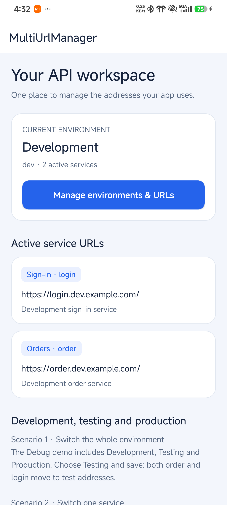
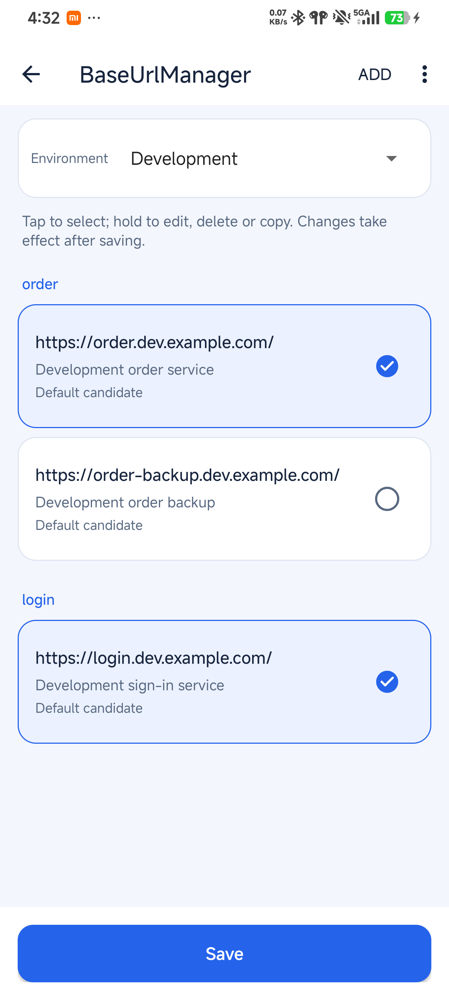
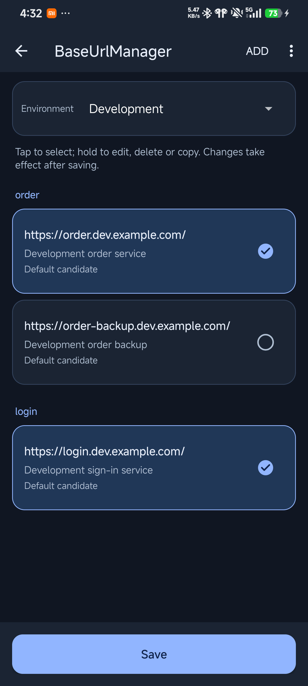

# MultiUrlManager

[English](README_EN.md) · [详细文档](docs/README.md) · [变更记录](CHANGELOG.md)

Android 多业务 Base URL 管理库。在应用内维护开发、测试、生产等环境，为订单、登录等业务分别选择地址，通过一次保存提交完整配置。核心库不依赖 Retrofit 或 OkHttp。

- **环境与业务分开管理**：切换环境同时切换整套服务，也可以只替换一个业务的候选地址。
- **草稿式编辑**：新增、编辑、删除、环境切换和重置先进入草稿，保存成功后生效，取消不会改动当前配置。
- **可观察的保存结果**：快照版本检测并发冲突；存储失败不报告成功；监听器一次收到完整前后状态。
- **兼容旧项目**：保留 1.0.x 的固定数组 JSON 与主要入口，旧地址迁移时保留；行为差异见下文。
- **原生 Android 页面**：支持深浅色、中英文、主题定制和 Activity Result。

**1.1.0 已于 2026-10-19 正式发布到 Maven Central**。发布提交 `063c92c` 已通过 [完整 CI 与 API 24/36 云端验证](https://github.com/logan0817/MultiUrlManager/actions/runs/39211596505)，此前功能实现已通过 Android 16 真机验证。公开产物、签名与校验和均已核对，详情见[发布记录](docs/ci-and-release.md#110-上传验收记录)。可直接按下方说明从 Maven Central 接入。

## 页面预览

以下三张英文截图来自 Android 16（API 36）真机，原始分辨率 1220 × 2712。首页为普通截图，下方案例可在应用内滚动查看。

<p>
  
  
  
</p>

管理页顶部“添加”打开地址表单，底部“保存”提交草稿；点击候选地址选择，长按编辑、删除或复制。重置只恢复当前环境的默认草稿，保存后才生效。

## 安装

支持 Android **API 24+**，库使用 Java 17 字节码。本仓库使用 JDK 17、Gradle Wrapper 8.14.3、AGP 8.13.0、compileSdk/targetSdk 36。宿主还需提供 AndroidX Activity Result 所需的 Activity/Fragment 依赖；常规 AppCompat 工程可直接使用下面的入口。

在宿主 `settings.gradle.kts` 中配置仓库：

```kotlin
dependencyResolutionManagement {
    repositories {
        google()
        mavenCentral()
    }
}
```

在宿主应用模块 `build.gradle.kts` 中添加：

```kotlin
dependencies {
    implementation("io.github.logan0817:multiurlmanager:1.1.0")
    // 下方示例 Activity 使用 AppCompat，宿主直接声明该依赖。
    implementation("androidx.appcompat:appcompat:1.7.1")
}
```

上述 `1.1.0` 已可从 [Maven Central 公开仓库](https://repo.maven.apache.org/maven2/io/github/logan0817/multiurlmanager/1.1.0/)获取，无需本地 Maven 仓库。仓库内的 [独立消费工程](fixtures/consumer)默认用于本轮本地 publication 验证；参与开发时的构建与验证命令见 [开发说明](docs/development.md)。

## 快速接入

### 1. 添加固定配置文件

在宿主应用模块创建 `src/main/assets/base_urls_config.json`。下面是一份完整配置：两个环境各包含订单和登录两项业务，首次安装默认生产环境，开发环境还提供订单备用地址。

```json
{
  "schemaVersion": 1,
  "defaultEnvironment": "production",
  "environments": [
    {
      "id": "production",
      "name": "Production",
      "requiredKeys": ["order", "login"],
      "urls": [
        {"configKey": "order", "url": "https://order.example.com/", "select": true, "remark": "Production order service"},
        {"configKey": "login", "url": "https://login.example.com/", "select": true, "remark": "Production sign-in service"}
      ]
    },
    {
      "id": "dev",
      "name": "Development",
      "requiredKeys": ["order", "login"],
      "urls": [
        {"configKey": "order", "url": "https://order.dev.example.com/", "select": true, "remark": "Development order service"},
        {"configKey": "order", "url": "https://order-backup.dev.example.com/", "select": false, "remark": "Development order backup"},
        {"configKey": "login", "url": "https://login.dev.example.com/", "select": true, "remark": "Development sign-in service"}
      ]
    }
  ]
}
```

`id` 是环境稳定标识，`name` 是显示名称，`configKey` 是代码查询使用的业务键。同一环境内同一业务键最多选择一个候选，`requiredKeys` 声明的业务必须在保存时有选择。示例使用保留域名，请替换为自己的服务地址；库本身不发送请求。

地址仅接受有效 HTTP(S) Base URL，禁止用户名密码、query 和 fragment；会规范化 host、默认端口并补末尾 `/`。缺失文件、未知 schema、重复地址或同组多选会明确报错。完整字段与代码配置方式见 [配置说明](docs/configuration.md) 和 [JSON Schema](docs/schemas/configuration-v1.schema.json)。

### 2. 在 Application 中初始化

```kotlin
package com.example.demo

import android.app.Application
import com.logan.multiurlmanager.library.BaseUrlManager

class App : Application() {
    override fun onCreate() {
        super.onCreate()
        BaseUrlManager.builder(this).build()
    }
}
```

在宿主 `AndroidManifest.xml` 的 `application` 上注册；已有 Application 时直接在其 `onCreate()` 中初始化。下方入口 Activity 需要 AppCompat 主题，已有兼容主题可沿用：

```xml
<manifest xmlns:android="http://schemas.android.com/apk/res/android">
    <application
        android:name="com.example.demo.App"
        android:theme="@style/Theme.AppCompat.DayNight.NoActionBar">
        <activity
            android:name="com.example.demo.SettingsEntryActivity"
            android:exported="false" />
    </application>
</manifest>
```

初始化读取固定 JSON 和已存配置，同一进程只需执行一次；以不同配置重复初始化会失败。初始化可能访问磁盘，不能放在每次请求或页面刷新中。管理 Activity 由库 manifest 自动合并注册，默认 `exported="false"`，无需重复声明。

### 3. 查询当前地址

```kotlin
import com.logan.multiurlmanager.library.BaseUrlManager

val manager = checkNotNull(BaseUrlManager.instance) { "Initialize BaseUrlManager in Application first" }
val orderUrl: String? = manager.getUrl("order")
val loginUrl: String? = manager.getUrl("login")

// 一次取得同一版本的整套有效地址，适合更新网络工厂。
val snapshot = manager.snapshot()
val environmentId: String = snapshot.environmentId
val effectiveUrls: Map<String, String> = snapshot.effectiveUrls()

// 只有显式提供 fallback 才会回退；不会把 fallback 写入配置。
val optionalUrl: String? = manager.getBaseUrl("files", "https://files.example.com/")?.url
```

未初始化时 `instance` 为 null；未选择的业务查询为 null。`snapshot()` 返回隔离副本，修改副本不会直接改变管理器，必须显式保存。不要通过修改已弃用的 `dynamicUrls` 集合更新配置。

### 4. 打开内置管理页

以下 Activity 可直接作为宿主配置入口；把它加入宿主 manifest，并从自己的按钮或开发者菜单进入。

```kotlin
package com.example.demo

import android.os.Bundle
import android.widget.Button
import android.widget.Toast
import androidx.appcompat.app.AppCompatActivity
import com.logan.multiurlmanager.library.BaseUrlManagerContract

class SettingsEntryActivity : AppCompatActivity() {
    private val settings = registerForActivityResult(BaseUrlManagerContract()) { result ->
        if (result != null) {
            Toast.makeText(
                this,
                "Environment: ${result.environmentId}; changed: ${result.changed}",
                Toast.LENGTH_SHORT
            ).show()
        }
    }

    override fun onCreate(savedInstanceState: Bundle?) {
        super.onCreate(savedInstanceState)
        setContentView(Button(this).apply {
            text = "Manage base URLs"
            setOnClickListener { settings.launch(null) }
        })
    }
}
```

取消返回 null；保存成功的 `BaseUrlManagerResult` 包含 `environmentId`、`revision`、`changed` 和当前环境已选择的 `urls`。页面操作只修改草稿，保存成功后统一生效。只有修改未选择的候选时也可能 `changed=true`，网络监听是否触发则取决于有效地址或当前环境是否改变。

## 用代码编辑与保存

UI 线程使用 `saveAsync`，磁盘写入在库的后台队列完成，回调在主线程。下面的函数把当前草稿切到配置文件中已有的生产环境，完整处理三种失败：

```kotlin
import android.content.Context
import android.widget.Toast
import com.logan.multiurlmanager.library.BaseUrlManager
import com.logan.multiurlmanager.library.SaveResult

fun selectProduction(context: Context) {
    val manager = checkNotNull(BaseUrlManager.instance)
    val draft = manager.snapshot().copy(environmentId = "production")
    manager.saveAsync(draft) { result ->
        val message = when (result) {
            is SaveResult.Success ->
                "Saved ${result.snapshot.environmentId}; changed: ${result.changed}"
            is SaveResult.Failure -> when (result.reason) {
                SaveResult.Reason.VALIDATION -> "Invalid configuration: ${result.message}"
                SaveResult.Reason.CONFLICT -> "Configuration changed. Reload before editing again."
                SaveResult.Reason.STORAGE -> "Storage failed. Confirm stored state before retrying."
            }
        }
        Toast.makeText(context, message, Toast.LENGTH_LONG).show()
    }
}
```

- **VALIDATION**：修正 URL、必选业务或环境信息后再提交。
- **CONFLICT**：草稿 revision 已过期；保留用户输入，重新读取快照并由用户确认合并，不能原样覆盖新配置。
- **STORAGE**：保存结果未被确认，管理器暂停后续写入；在后台成功调用 `refreshData()` 确认磁盘状态，或重启后确认，再编辑保存。内置页面提供“重新加载”，读取失败会保留草稿与保护状态。

无变化保存返回 `Success(changed=false)`。同步 `save`、`select`、`switchEnvironment`、`restoreDefaults` 和旧写入 API 会访问磁盘，须由宿主放到后台线程；旧写入入口失败会抛出异常。更完整的快照编辑与线程约定见 [API 文档](docs/api.md)。

## 监听变化与更新网络对象

监听器在主线程按提交顺序收到完整前后快照；只有当前环境或有效地址映射改变时才通知。下面的对象保存一份可替换的有效映射，并明确管理监听器生命周期：

```kotlin
import com.logan.multiurlmanager.library.BaseUrlManager
import com.logan.multiurlmanager.library.UrlChangeListener
import java.io.Closeable

class ActiveUrls(private val manager: BaseUrlManager) : Closeable {
    @Volatile
    var urls: Map<String, String> = manager.snapshot().effectiveUrls()
        private set

    private val listener = UrlChangeListener { _, current ->
        urls = current.effectiveUrls()
    }

    init {
        manager.addListener(listener)
        urls = manager.snapshot().effectiveUrls()
    }

    override fun close() {
        manager.removeListener(listener)
    }
}
```

在持有者生命周期开始时创建，在结束时调用 `close()`；Activity 只需观察可见阶段时，可在 `onStart()` 创建、`onStop()` 关闭。应用级网络工厂则按自身生命周期持有。监听注册后不会自动回放当前状态，因此示例显式读取快照。

**保存配置不会自动修改已经创建的 Retrofit、OkHttp 或 Service。** 宿主在监听器或 Activity Result 中获取整份有效映射，重建变化的 Service 并替换引用；正在执行的请求继续使用原 URL。跨环境 token、cookie、数据库与业务缓存也由宿主管理。可编译且不依赖网络框架的 [网络接入示例](app/src/main/java/com/logan/multiurlmanager/NetworkIntegrationExample.kt) 演示 Service 替换，详见 [页面与网络生效](docs/ui-and-network.md)。

## Debug、Release 与旧版本升级

库读取最终打进宿主 APK 的 `assets/base_urls_config.json`，不根据库自身构建类型选环境，也不要求用 Kotlin 定义固定地址。

| 宿主文件布局 | 打包结果与首次默认环境 |
| --- | --- |
| 只有 `src/main/assets/base_urls_config.json` | Debug、Release 都使用这一份；由其 `defaultEnvironment` 决定，Release 不会自动切生产 |
| 增加 `src/release/assets/base_urls_config.json` | Release 整文件覆盖 main 同名文件，以 Release 文件为准，不合并环境数组 |
| 增加 `src/debug/assets/base_urls_config.json` | Debug 使用该覆盖文件；其他变体仍按各自源集取值 |

首次默认环境的优先级是 **显式 `setDefaultEnvironment` / `setFileConfigKey` > JSON 的 `defaultEnvironment` > 兼容回退 `release_defaults`**。选择的环境必须存在；不要给缺少 schemaVersion 的旧数组格式直接添加新字段。

仓库 Demo 的 main 文件包含 dev/test/production、默认 dev；release 文件只包含 production、默认 production。Release 配置用于首次初始化，**覆盖安装保留已有状态**，不会强制生产，也不会删除已有环境。生产包如需锁定生产，应由宿主另外定义运行与迁移策略。

从 1.0.x 升级时，有效旧地址（包括旧版自动写入的默认地址）会迁入当前 `legacy` 历史环境（同名冲突时使用 `legacy-1` 等可用 id）；新版默认值不会自动覆盖旧选择或重命名旧业务键。旧 `debug_defaults` / `release_defaults` 固定数组 JSON、`setFileConfigKey`、旧 Activity 启动与结果解析入口继续保留。`dynamicUrls` getter 现为副本，直接修改集合不生效；清空、持久化失败与默认值合并等行为边界见 [升级迁移](docs/migration-1.1.md)。

## 常用 API

| 入口 | 用途 |
| --- | --- |
| `builder(context).build()` | 从固定 JSON 初始化；也支持 `setEnvironments` / `setDefaultProvider` |
| `getUrl(key)` / `getBaseUrl(key, fallback)` | 查询当前选择；可选显式 fallback |
| `snapshot()` / `snapshot().effectiveUrls()` | 取得隔离的完整状态 / 当前环境有效映射 |
| `saveAsync(snapshot, callback)` | 后台持久化，主线程回调完整结果 |
| `save(snapshot)` | 同步提交，检测 revision、校验和存储失败 |
| `select(key, url)` / `switchEnvironment(id)` | 同步便捷提交；返回 `SaveResult` |
| `restoreDefaults()` | 同步恢复当前环境默认候选 |
| `defaultEnvironment(id)` | 取得指定环境默认副本，不改变当前状态 |
| `addListener` / `removeListener` | 订阅与取消订阅有效配置变化 |
| `BaseUrlManagerContract` | 内置页面的 Activity Result 入口 |

Java 调用与旧接口见 [Java 示例](app/src/main/java/com/logan/multiurlmanager/JavaIntegrationExample.java) 和 [API 文档](docs/api.md)。库面向**单进程**配置管理，不提供多进程写入同步。

## 自定义页面主题

在宿主 `res/values/styles.xml` 中继承库主题，例如：

```xml
<resources>
    <style name="AppUrlManagerTheme" parent="BaseUrlManagerTheme">
        <item name="base_url_toolbar_bg_color">#EEF2FF</item>
        <item name="base_url_page_title_text_color">#172554</item>
    </style>
</resources>
```

在宿主 manifest 覆盖库 Activity 的主题：

```xml
<manifest xmlns:android="http://schemas.android.com/apk/res/android"
    xmlns:tools="http://schemas.android.com/tools">
    <application>
        <activity
            android:name="com.logan.multiurlmanager.library.BaseUrlManagerActivity"
            android:theme="@style/AppUrlManagerTheme"
            tools:replace="android:theme" />
    </application>
</manifest>
```

为 `values-night` 提供对应深色主题颜色。状态栏安全区与 Toolbar 共用 `base_url_toolbar_bg_color`，系统栏图标随实际背景明暗适配。完整属性见 [attrs.xml](library-android/src/main/res/values/attrs.xml)；保留的 `base_url_btn_add_*` 属性名现用于底部保存主按钮，以兼容旧主题。

## 更多文档与贡献

| 主题 | 内容 |
| --- | --- |
| [配置](docs/configuration.md) | JSON 字段、代码配置、校验、构建源集与默认值更新 |
| [API](docs/api.md) | 快照、保存、线程、监听、Java 与二进制兼容边界 |
| [页面与网络](docs/ui-and-network.md) | 草稿、主题、返回结果和网络生效时机 |
| [升级迁移](docs/migration-1.1.md) | 旧数据归属、集合行为变化、备份与降级限制 |
| [开发](docs/development.md) | 工具链、测试和真实 AAR/R8 消费 |
| [CI 与发布](docs/ci-and-release.md) | 必需检查、产物身份、发布与失败恢复 |
| [排障](TROUBLESHOOTING.md) | 初始化、存储、构建与混淆问题 |
| [贡献](CONTRIBUTING.md) / [变更记录](CHANGELOG.md) | 变更要求与开发版本状态 |

问题反馈请提供库版本、Android 版本、构建类型、脱敏配置、复现步骤和日志；不要提交密钥、真实 token 或私有服务凭据。仓库提供 Bug 与功能建议模板，贡献前请阅读贡献说明。

项目参考 [jenly1314/BaseUrlManager](https://github.com/jenly1314/BaseUrlManager)，按多业务地址扩展环境管理，采用 [MIT 许可证](LICENSE)。
