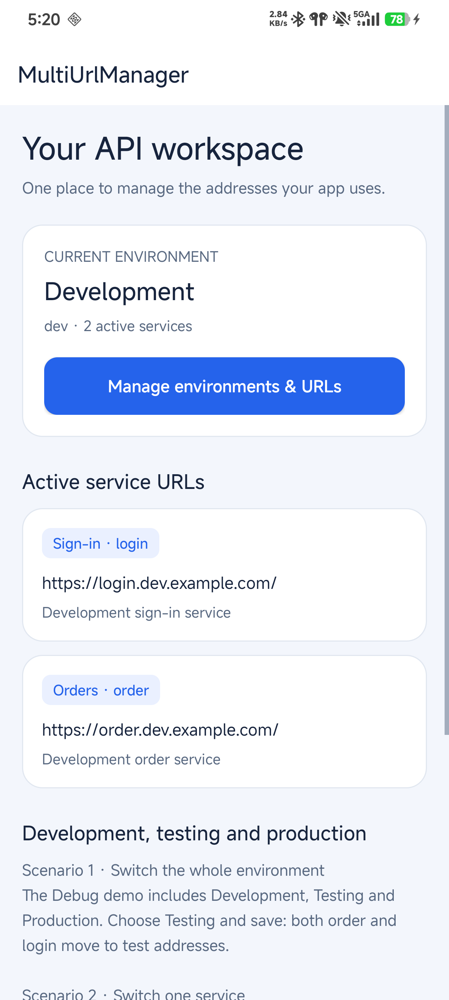
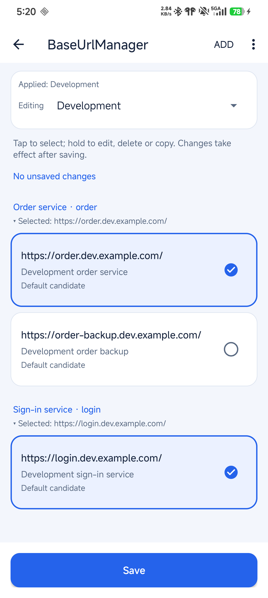
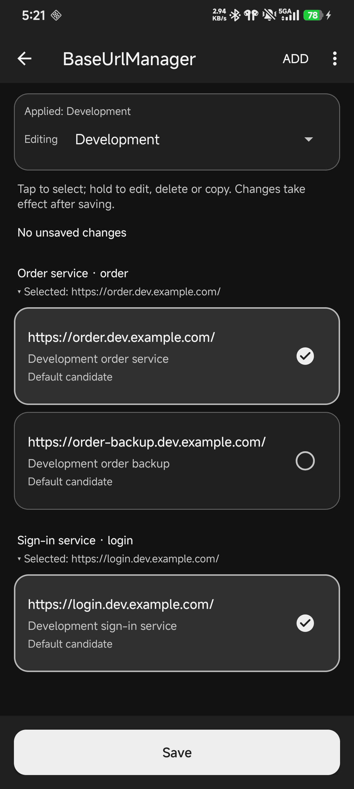

# MultiUrlManager

[English](README_EN.md) · [详细文档](docs/README.md) · [更新记录](CHANGELOG.md) · [1.3.0 Release](https://github.com/logan0817/MultiUrlManager/releases/tag/v1.3.0)

**在 Android 应用内切换开发、测试、生产环境，并为不同业务管理各自的服务器地址。** 自带管理页面，选择地址后点击“保存”，整套配置一起生效，重启应用后保留选择。

例如：你的 App 同时调用订单和登录服务。联调时切到开发环境，两项业务一起切换；开发环境的订单主服务不可用时，也可以只选择订单备用地址，登录服务保持原样。

当前稳定版 **1.3.0**，已发布到 Maven Central。核心库不依赖 Retrofit 或 OkHttp；本版新增 JSON 文件导入导出、差异预览，并修复默认配置升级和页面编辑的可靠性问题。

当前源码准备 **1.3.1（尚未发布）**，包含深色样式修正和选中态主题属性；候选核心坐标为 `io.github.logan0817:multiurlmanager:1.3.1`。下方安装示例继续使用已发布的 `1.3.0`。

配置文件可通过系统文件选择器在同事之间交换，支持默认合并和选定环境替换，操作步骤见[团队交换配置](#团队交换配置)。

## 从这里开始

- **第一次接入**：按下方[快速接入](#快速接入)完成配置、初始化、打开页面和切换验证。
- **已有 Retrofit / OkHttp**：先完成核心接入，再选择[网络生效方式](#让网络请求使用新地址)。
- **正式包只允许生产地址**：查看[固定环境模式](#正式包固定生产环境)。
- **从旧版升级**：先看[升级说明](#从旧版升级)，已有选择不会被首次默认值直接覆盖。

### 先认识三个概念

| 概念 | 在示例中 | 用来做什么 |
| --- | --- | --- |
| 环境 | `production`、`dev` | 一整套服务器配置，如生产环境、开发环境 |
| 业务键 `configKey` | `order`、`login` | 代码用它查询订单、登录服务的地址；不是环境名称 |
| 候选地址 | 订单主地址、备用地址 | 同一环境、同一业务可有多个地址，同时最多选中一个 |

Base URL 是接口共用的地址前缀，例如 `https://order.example.com/api/`；具体接口路径如 `orders/42` 由你的网络代码拼接。**核心库负责管理地址，不会自动修改已创建的 Retrofit / OkHttp 对象。**

## 页面预览

依次为 Demo 首页、管理页和深色管理页，来自 Android 16 真机。Demo 展示配置与交互，示例域名不提供真实接口。

<p>
  
  
  
</p>

点击候选地址进行选择，长按可编辑、删除或复制；“添加”打开地址表单。“重置”只恢复当前环境的默认草稿，点击“保存”后才生效。

## 快速接入

下面以 **Kotlin + Gradle Kotlin DSL**、应用模块名为 `app` 的项目为例。已有文件时合并对应内容，不要覆盖原有 Application、Manifest 或 Gradle 配置。

先区分手机能否运行与项目能否编译：

| 检查项 | 接入前确认 |
| --- | --- |
| `minSdk` | 设为 **24 或更高**；24 对应 Android 7.0，它决定能安装到哪些手机 |
| `compileSdk` | 当前传递依赖要求 **至少 35**；它是编译使用的 SDK，不代表手机也要 Android 15 |
| Android Gradle Plugin（AGP） | 当前传递依赖的元数据要求 **至少 8.6.0**；它是 Android 构建插件 |
| JDK / 字节码 | 本仓库使用 **JDK 17**；库按 Java 17 字节码发布 |

**已验证组合：JDK 17、Gradle 8.14.3、AGP 8.13.0、Kotlin 1.9.23、compileSdk 36。** 上述依赖最低要求不等于每一种版本组合都已验证。旧项目若出现 `checkDebugAarMetadata` 错误，先检查 `compileSdk` 和 AGP，而不只是修改 `minSdk`。项目构建配置见[开发说明](docs/development.md#工程与工具链)。

### 1. 添加依赖

在项目根目录的 `settings.gradle.kts` 中，确认已有以下仓库：

```kotlin
dependencyResolutionManagement {
    repositories {
        google()
        mavenCentral()
    }
}
```

在应用模块的 `app/build.gradle.kts` 中添加核心库，然后执行 Android Studio 的 **Sync Project with Gradle Files**：

```kotlin
dependencies {
    implementation("io.github.logan0817:multiurlmanager:1.3.0")
}
```

第一次接入只需核心库，内置管理页已经包含在其中。需要自动路由时再添加[可选网络制品](#让网络请求使用新地址)；两者均可直接从 Maven Central 获取。

### 2. 创建地址配置

在 `app/src/main/assets/` 下新建 `base_urls_config.json`，没有 `assets` 目录就先创建。文件名必须一致。复制下面的完整示例，再把 URL 换成你自己的地址：

```json
{
  "schemaVersion": 1,
  "defaultEnvironment": "production",
  "businessNames": {"order": "Order service", "login": "Sign-in service"},
  "environments": [
    {
      "id": "production",
      "name": "Production",
      "requiredKeys": ["order", "login"],
      "urls": [
        {"configKey": "order", "url": "https://order.example.com/", "select": true, "remark": "Production order service"},
        {"configKey": "login", "url": "https://login.example.com/", "select": true, "remark": "Production sign-in service"}
      ]
    },
    {
      "id": "dev",
      "name": "Development",
      "requiredKeys": ["order", "login"],
      "urls": [
        {"configKey": "order", "url": "https://order.dev.example.com/", "select": true, "remark": "Development order service"},
        {"configKey": "order", "url": "https://order-backup.dev.example.com/", "select": false, "remark": "Development order backup"},
        {"configKey": "login", "url": "https://login.dev.example.com/", "select": true, "remark": "Development sign-in service"}
      ]
    }
  ]
}
```

这份配置包含生产、开发两个环境，每个环境都有订单和登录业务。先关注以下字段：

| 字段 | 如何填写 |
| --- | --- |
| `schemaVersion` | 当前填 `1`，表示配置格式版本，与库版本 `1.3.0` 不同 |
| `defaultEnvironment` | 首次使用的环境 id；示例为 `production`，改为 `dev` 可让新安装默认开发环境 |
| `id` / `name` | 环境的稳定标识 / 页面显示名称；`id` 必须唯一，其他字段引用它时保持一致 |
| `businessNames` | 可选的业务展示名映射；例如让 `order` 在页面显示为 Order service，代码仍使用 `order` |
| `configKey` | 业务键；代码里用同样的字符串查询，例如 `getUrl("order")` |
| `select` | `true` 表示默认选中；同一环境、同一业务最多一个 `true` |
| `requiredKeys` | 当前环境保存时必须选好地址的业务；示例要求订单、登录都不能缺 |
| `remark` | 可选备注，帮助使用者区分主地址与备用地址 |

**已有安装会优先保留保存过的选择。** 改 `defaultEnvironment` 不会强制覆盖设备当前环境。示例中的 `example.com` 域名仅用于演示，不能用来验证真实接口是否可用。

URL 只接受 HTTP(S)，不能带用户名密码、查询参数 `?…` 或片段 `#…`；建议写完整的末尾 `/`，核心也会自动补齐。未知格式版本、重复候选或同组多选会明确报错。AAR 内含兼容用空配置，宿主漏放 JSON 时可能显示空环境；请核对宿主 assets 文件，不能把初始化成功当作业务地址已配置。完整规则见[配置说明](docs/configuration.md)。

### 3. 在 Application 初始化一次

新建 `App.kt`。下面的 `com.example.demo` 是示例包名，请替换成自己项目的包名；已有 Application 时，把初始化调用放进原有 `onCreate()`，无需再建一个。

```kotlin
package com.example.demo

import android.app.Application
import com.logan.multiurlmanager.library.BaseUrlManager

class App : Application() {
    override fun onCreate() {
        super.onCreate()
        BaseUrlManager.builder(this).build()
    }
}
```

在 `app/src/main/AndroidManifest.xml` 的现有 `<application>` 上设置 `android:name`：

```xml
<manifest xmlns:android="http://schemas.android.com/apk/res/android">
    <application
        android:name="com.example.demo.App" />
</manifest>
```

同一进程只需初始化一次。初始化读取包内配置和已存状态，可能访问磁盘，不要放进每次请求或页面刷新中；同进程用不同配置重复初始化会失败。未初始化时，`BaseUrlManager.instance` 为 `null`。

### 4. 读取地址，确认配置已加载

在同一示例包下新建 `UrlReader.kt`。这个函数把当前环境和地址输出到 Logcat，第 5 步会在现有页面调用它：

```kotlin
package com.example.demo

import android.util.Log
import com.logan.multiurlmanager.library.BaseUrlManager

fun printCurrentUrls() {
    val manager = checkNotNull(BaseUrlManager.instance) { "Initialize BaseUrlManager in Application first" }
    val snapshot = manager.snapshot()
    val urls = snapshot.effectiveUrls()
    Log.d("MultiUrlDemo", "environment=${snapshot.environmentId}")
    Log.d("MultiUrlDemo", "order=${urls["order"]}")
    Log.d("MultiUrlDemo", "login=${urls["login"]}")
}
```

只查一个业务时可使用 `manager.getUrl("order")`，没有选中地址会返回 `null`。示例通过 `snapshot()` 一次读取同一版本的完整映射，避免分别查询时读到不同次保存的配置。函数应在 Application 初始化之后调用。

新安装、按原示例配置运行时，Logcat 用 `MultiUrlDemo` 过滤，应看到：

```text
environment=production
order=https://order.example.com/
login=https://login.example.com/
```

### 5. 从现有页面打开管理页

在你现有 Activity 的按钮点击回调中调用这一行，`this` 指向该 Activity：

```kotlin
startActivity(android.content.Intent(this, com.logan.multiurlmanager.library.BaseUrlManagerActivity::class.java))
```

库的管理页已通过 Manifest 合并自动注册，并有自己的主题。只需打开它时，不用新建入口 Activity，也不用额外添加 AppCompat 或更换宿主主题。

为核对保存后的地址，在现有 Activity 的 `onResume()` 中调用第 4 步的函数；已有 `onResume()` 时只合并调用，不要重复声明方法：

```kotlin
override fun onResume() {
    super.onResume()
    printCurrentUrls()
}
```

`UrlReader.kt` 与该 Activity 使用同一包名；不在同一包时导入 `printCurrentUrls`。这样首次进入和从管理页返回时都会输出当前配置。需要区分保存与取消、接收返回结果时，继续看[接收管理页保存结果](#接收管理页保存结果)。

### 6. 验证一次切换

1. 运行 App，进入刚才添加入口的页面，在 Logcat 用 `MultiUrlDemo` 过滤，确认看到了第 4 步的初始地址。
2. 点击自己的按钮打开管理页，选择 **Development** 环境，再点击底部“保存”。只切换下拉框还不会生效。
3. 返回后检查 Logcat：环境应为 `dev`，订单应为 `https://order.dev.example.com/`，登录应为 `https://login.dev.example.com/`。
4. 再次打开管理页，选中订单备用地址并保存。此时订单应为 `https://order-backup.dev.example.com/`，登录保持不变。
5. 关闭并重新启动 App，回到入口页面，检查刚才的选择仍然保留。

如果已经替换为自己的 URL，就以自己填写的地址为准。取消或放弃草稿不会改动当前配置；所有页面编辑都要保存成功后才生效。

到这里已验证地址管理。接下来按项目需要，把这些地址交给网络层。

## 让网络请求使用新地址

| 你的接入方式 | 保存后还要做什么 |
| --- | --- |
| 仅使用核心库，自己创建 Retrofit / 其他网络对象 | 在监听或页面结果回调中读取有效地址，重建受影响的 Service 并替换引用，见[监听示例](#监听配置变化) |
| 使用可选 OkHttp 路由 | 配置 `UrlRoutingInterceptor`、来源 Base URL 和 `RouteKey`，后续受管请求进入拦截器时读取已保存地址，无需重建 Service |

需要第二种方式时，在核心依赖之外添加：

```kotlin
dependencies {
    implementation("io.github.logan0817:multiurlmanager-okhttp:1.3.0")
}
```

**添加依赖还不够。** 请继续按[网络路由接入指南](docs/network-routing.md)配置拦截器和请求标记；未带 `RouteKey` 的请求保持原样。网络请求还需要宿主声明 `INTERNET` 权限，Retrofit 依赖也由宿主声明。

已经进入路由拦截器的请求沿用进入时的配置。两种方式下，跨环境 token、cookie、登录态、数据库和业务缓存都由宿主管理；使用路由时，鉴权拦截器放在路由之后，并使用该请求的 `RouteContext` 选择凭据，详见指南。

## 正式包固定生产环境

默认环境只决定首次选择。常见需求是 **Debug 可切换，Release 固定生产**：由宿主判断自己的构建标识，再决定是否启用固定模式。

下面是第 3 步 Application 的替代版本。使用时将 Manifest 的 `android:name` 改为 `com.example.demo.ReleaseAwareApp`（替换为实际包名）；已有 Application 则合并 `onCreate()` 中的初始化逻辑，不要同时初始化两次：

```kotlin
package com.example.demo

import android.app.Application
import com.example.demo.BuildConfig
import com.logan.multiurlmanager.library.BaseUrlManager

class ReleaseAwareApp : Application() {
    override fun onCreate() {
        super.onCreate()
        BaseUrlManager.builder(this).apply {
            if (!BuildConfig.DEBUG) {
                setFixedEnvironment("production")
            }
        }.build()
    }
}
```

`BuildConfig` 必须来自**宿主应用的 namespace**；如果 Application 位于子包，请调整 import，不要导入库的 BuildConfig。若项目没有生成它，在 `app/build.gradle.kts` 的 `android` 块中启用：

```kotlin
android {
    buildFeatures {
        buildConfig = true
    }
}
```

本示例按宿主的 `BuildConfig.DEBUG` 判断；有自定义构建类型时，按项目规则调整条件。所有构建都要固定时，可去掉 `if`，直接调用 `setFixedEnvironment("production")`。库本身不会自动区分 Debug / Release。

固定模式只使用指定环境的包内定义，`production` 必须存在。管理页只读，不读取或覆盖设备之前保存的调试配置；下次新进程使用普通模式，仍可恢复原有选择。**固定模式缺少某业务的选中地址时，不能通过 fallback 补入其他地址；`getBaseUrl(key, fallback)` 会抛出异常。** 应在包内配置所需业务，或通过 `getUrl(key)` 的 `null` 结果处理缺失。

要让 Release APK 仅包含生产配置，再将生产专用的完整 JSON 放入 `app/src/release/assets/base_urls_config.json`，它会整文件覆盖 main 同名文件，不合并环境数组。普通模式下，单独覆盖此文件仍不会清除设备已存选择。固定模式也不负责裁剪其他源码中的测试地址，详见[配置与打包说明](docs/configuration.md#debug--release-打包使用哪份配置)。

## 团队交换配置

此功能从 1.3.0 开始提供。无需相机或存储权限，直接使用系统文件选择器：

1. 发送方在管理页菜单选择“导出配置”，勾选环境并保存 JSON；导出的是已保存状态，不含当前草稿。
2. 接收方选择“导入配置”，打开同事提供的文件，选择环境和“合并”或“替换选定环境”。
3. 查看新增、删除、备注及选择变化；确认后仅进入草稿，最后点击“保存”才生效。

合并默认保留本机选择；替换保留宿主的必选业务约束。可以新增环境，但不能新增未声明的业务键，也不会自动切换当前环境。固定模式只能导出当前固定配置。

可直接参考[团队开发配置文件](docs/examples/team-development.json)和[完整操作、容量与错误说明](docs/configuration-transfer.md)。超限或解析失败不部分应用，原配置和草稿保留。

## 按需进阶

按你接下来要做的事选择，不必从头通读：

| 我想做什么 | 直接看这里 |
| --- | --- |
| 得知用户保存了什么、是否取消 | [接收管理页保存结果](#接收管理页保存结果) |
| 不开页面，直接用代码切换环境 | [用代码编辑与保存](#用代码编辑与保存) |
| 地址变化时更新自己的网络对象 | [监听配置变化](#监听配置变化) |
| 复用 Retrofit Service，切换后请求自动选址 | [网络路由完整示例](docs/network-routing.md#2-创建可发送请求的示例页面) |
| Debug 可切换，正式包固定生产 | [固定环境初始化](#正式包固定生产环境) |
| 调整页面配色 | [自定义页面主题](#自定义页面主题) |

完整字段与 API 约定以[配置](docs/configuration.md)和 [API 文档](docs/api.md)为准。

### 接收管理页保存结果

<details>
<summary>展开 Activity Result 完整接入示例</summary>

需要在返回时接收保存结果，可使用下面的按钮页面。此示例入口继承 `AppCompatActivity`，因此在 `app/build.gradle.kts` 中显式添加 AppCompat；已有兼容版本可沿用：

```kotlin
dependencies {
    implementation("androidx.appcompat:appcompat:1.7.1")
}
```

新建 `SettingsEntryActivity.kt`，与 `UrlReader.kt` 放在同一包下。打开页面、保存返回时都会打印当前配置：

```kotlin
package com.example.demo

import android.os.Bundle
import android.widget.Button
import android.widget.Toast
import androidx.appcompat.app.AppCompatActivity
import com.logan.multiurlmanager.library.BaseUrlManagerContract

class SettingsEntryActivity : AppCompatActivity() {
    private val settings = registerForActivityResult(BaseUrlManagerContract()) { result ->
        if (result != null) {
            printCurrentUrls()
            Toast.makeText(
                this,
                "Environment: ${result.environmentId}; changed: ${result.changed}",
                Toast.LENGTH_SHORT
            ).show()
        }
    }

    override fun onCreate(savedInstanceState: Bundle?) {
        super.onCreate(savedInstanceState)
        printCurrentUrls()
        setContentView(Button(this).apply {
            text = "Manage base URLs"
            setOnClickListener { settings.launch(null) }
        })
    }
}
```

在现有 Manifest 的 `<application>` 内添加这个**示例入口**。主题只设置给它；库的管理页已自动注册，无需重复声明：

```xml
<manifest xmlns:android="http://schemas.android.com/apk/res/android">
    <application>
        <activity
            android:name="com.example.demo.SettingsEntryActivity"
            android:theme="@style/Theme.AppCompat.DayNight.NoActionBar"
            android:exported="false" />
    </application>
</manifest>
```

从你现有 Activity 的按钮或开发者菜单调用下面这一行，进入示例入口（包名改为你的实际包名）：

```kotlin
startActivity(android.content.Intent(this, com.example.demo.SettingsEntryActivity::class.java))
```

已有 `ComponentActivity` 或 AndroidX `Fragment` 可以直接注册 `BaseUrlManagerContract`，无需换基类；显式声明自己使用的 Activity/Fragment 依赖即可。

取消页面返回 `null`；保存成功返回 `BaseUrlManagerResult`，包含 `environmentId`、`revision`、`changed` 和当前环境已选择的 `urls`。`changed` 也可能来自未选中候选的修改，不能单凭它断定网络目标变化。

</details>

### 用代码编辑与保存

UI 线程使用 `saveAsync`：磁盘写入在库的后台队列完成，回调在主线程。示例把当前快照切到配置中已有的生产环境，并处理保存失败：

<details>
<summary>展开完整保存示例与失败处理</summary>

```kotlin
import android.content.Context
import android.widget.Toast
import com.logan.multiurlmanager.library.BaseUrlManager
import com.logan.multiurlmanager.library.SaveResult

fun selectProduction(context: Context) {
    val manager = checkNotNull(BaseUrlManager.instance)
    val draft = manager.snapshot().copy(environmentId = "production")
    manager.saveAsync(draft) { result ->
        val message = when (result) {
            is SaveResult.Success ->
                "Saved ${result.snapshot.environmentId}; changed: ${result.changed}"
            is SaveResult.Failure -> when (result.reason) {
                SaveResult.Reason.VALIDATION -> "Invalid configuration: ${result.message}"
                SaveResult.Reason.CONFLICT -> "Configuration changed. Reload before editing again."
                SaveResult.Reason.STORAGE -> "Storage failed. Confirm stored state before retrying."
            }
        }
        Toast.makeText(context, message, Toast.LENGTH_LONG).show()
    }
}
```

- **VALIDATION**：修正 URL、必选业务或环境信息后再提交。
- **CONFLICT**：草稿 revision 已过期；保留用户输入，重新读取快照并由用户确认合并，不能原样覆盖新配置。
- **STORAGE**：保存结果未被确认，管理器暂停后续写入；在后台成功调用 `refreshData()` 确认磁盘状态，或重启后确认，再编辑保存。内置页面提供“重新加载”，读取失败会保留草稿与保护状态。

无变化保存返回 `Success(changed=false)`。同步 `save`、`select`、`switchEnvironment`、`restoreDefaults` 和旧写入 API 会访问磁盘，须由宿主放到后台线程；旧写入入口失败会抛出异常。

</details>

### 监听配置变化

只在当前环境或有效地址映射改变时通知，监听器在主线程按提交顺序收到完整前后快照。下面维护一份最新映射，宿主可在监听中衔接自己的网络工厂：

<details>
<summary>展开监听注册与释放示例</summary>

```kotlin
import com.logan.multiurlmanager.library.BaseUrlManager
import com.logan.multiurlmanager.library.UrlChangeListener
import java.io.Closeable

class ActiveUrls(private val manager: BaseUrlManager) : Closeable {
    @Volatile
    var urls: Map<String, String> = manager.snapshot().effectiveUrls()
        private set

    private val listener = UrlChangeListener { _, current ->
        urls = current.effectiveUrls()
    }

    init {
        manager.addListener(listener)
        urls = manager.snapshot().effectiveUrls()
    }

    override fun close() {
        manager.removeListener(listener)
    }
}
```

在持有者生命周期开始时创建，在结束时调用 `close()`；Activity 只需观察可见阶段时，可在 `onStart()` 创建、`onStop()` 关闭。应用级网络工厂按自身生命周期持有。监听注册后不会自动回放当前状态，因此示例显式读取快照。

这个对象只更新地址映射。仅使用核心库时，宿主还需要重建变化的 Service 并替换引用；正在执行的请求继续使用原 URL。可编译的[网络接入示例](app/src/main/java/com/logan/multiurlmanager/NetworkIntegrationExample.kt)演示 Service 替换，详见[页面与网络生效](docs/ui-and-network.md)。

</details>

### 常用 API 速查

| 入口 | 用途 |
| --- | --- |
| `builder(context).build()` | 从包内 JSON 初始化，也支持 `setEnvironments` / `setDefaultProvider` |
| `getUrl(key)` / `getBaseUrl(key, fallback)` | 查询当前选择；普通模式可显式提供 fallback，不写入配置；固定模式缺失选中地址时禁止 fallback |
| `snapshot()` / `snapshot().effectiveUrls()` | 取得隔离的完整状态 / 当前环境有效映射 |
| `saveAsync(snapshot, callback)` | 后台持久化，主线程回调完整结果 |
| `save(snapshot)` | 同步提交，检测 revision、校验和存储失败 |
| `select(key, url)` / `switchEnvironment(id)` | 同步便捷提交，返回 `SaveResult` |
| `restoreDefaults()` | 同步恢复当前环境默认候选 |
| `defaultEnvironment(id)` | 取得指定环境默认副本，不改变当前状态 |
| `addListener` / `removeListener` | 订阅与取消订阅有效配置变化 |
| `BaseUrlManagerContract` | 内置页面的 Activity Result 入口 |

Java 调用见 [Java 示例](app/src/main/java/com/logan/multiurlmanager/JavaIntegrationExample.java)。库面向**单进程**配置管理，不提供多进程写入同步。

### 自定义页面主题

<details>
<summary>展开主题与 Manifest 配置</summary>

在宿主 `res/values/styles.xml` 中继承库主题，例如：

```xml
<resources>
    <style name="AppUrlManagerTheme" parent="BaseUrlManagerTheme">
        <item name="base_url_toolbar_bg_color">#EEF2FF</item>
        <item name="base_url_page_title_text_color">#172554</item>
    </style>
</resources>
```

在宿主 manifest 覆盖库 Activity 的主题：

```xml
<manifest xmlns:android="http://schemas.android.com/apk/res/android"
    xmlns:tools="http://schemas.android.com/tools">
    <application>
        <activity
            android:name="com.logan.multiurlmanager.library.BaseUrlManagerActivity"
            android:theme="@style/AppUrlManagerTheme"
            tools:replace="android:theme" />
    </application>
</manifest>
```

为 `values-night` 提供对应深色主题颜色。1.3.1 源码新增 `base_url_item_selected_bg_color`（选中底色）和 `base_url_item_selected_stroke_color`（选中边框），可在自定义主题中覆盖；正文与备注沿用原颜色。深色默认使用灰阶，选中卡片保持深底浅字，弹窗、菜单和下拉列表沿用页面主题。完整深浅色示例见[主题配置](docs/ui-and-network.md#自定义主题)。状态栏安全区与 Toolbar 共用 `base_url_toolbar_bg_color`，系统栏图标随实际背景明暗适配。完整属性见 [attrs.xml](library-android/src/main/res/values/attrs.xml)；保留的 `base_url_btn_add_*` 属性名现用于底部保存主按钮，以兼容旧主题。

</details>

## 从旧版升级

从 1.2.0 升到 1.3.0，已有选择和自定义地址继续保留。带 `schemaVersion` 的 JSON 会严格检查字段类型；请使用真正的布尔值和整数，避免把它们写成字符串。旧数组配置和旧持久化数据继续兼容读取。默认配置更新实际地址后，恢复的旧草稿会报告版本冲突，请重新加载再编辑。

1.1.x 升级后的普通模式继续保留已有选择；固定模式需要宿主主动启用。完整变化见[更新记录](CHANGELOG.md)。

从 1.0.x 升级时，有效旧地址会迁入当前 `legacy` 历史环境（重名时使用 `legacy-1` 等可用 id），首次保持旧地址。新版默认值不会自动覆盖旧选择或重命名业务键。旧数组 JSON、`setFileConfigKey` 和旧 Activity 结果解析入口继续保留；`dynamicUrls` getter 现为副本，直接修改集合不再生效。

迁移前请阅读[升级迁移](docs/migration-1.1.md)，其中包含旧数据归属、默认值更新、备份与降级限制。不要通过清空用户数据来掩盖迁移问题。

## 常见疑问

| 现象 | 优先检查 |
| --- | --- |
| `instance` 是 `null` | Application 是否在 Manifest 注册，以及初始化是否成功 |
| 管理页能切换，请求却没变 | 是否已保存；核心接入是否更新了网络对象，路由接入是否正确配置标记与拦截器 |
| 改 JSON 后仍显示旧环境 | 普通模式会保留已有选择；`defaultEnvironment` 只决定首次默认值 |
| 保存报错或冲突 | 查看具体失败原因；必选业务是否已选择、草稿是否过期，必要时先保留输入再重新加载 |
| 页面提示只读 | 是否启用了 `setFixedEnvironment`；固定模式下不能编辑或切换 |

更多诊断见[常见问题](TROUBLESHOOTING.md)。

## 更多文档与贡献

| 主题 | 内容 |
| --- | --- |
| [配置](docs/configuration.md) | JSON 字段、业务展示名、代码配置、固定模式、构建源集与默认值更新 |
| [网络路由](docs/network-routing.md) | 可选 OkHttp / Retrofit 接入、请求切换时点与鉴权边界 |
| [API](docs/api.md) | 快照、保存、线程、监听、Java 与兼容边界 |
| [页面与网络](docs/ui-and-network.md) | 草稿、变更摘要、主题、返回结果和网络生效 |
| [升级迁移](docs/migration-1.1.md) | 旧数据、默认值合并、备份与降级限制 |
| [开发](docs/development.md) | 工具链、测试和真实 AAR / R8 消费 |
| [CI 与发布](docs/ci-and-release.md) | 检查门槛、产物验签、发布与失败恢复 |
| [贡献](CONTRIBUTING.md) / [更新记录](CHANGELOG.md) | 贡献要求与版本变化 |

问题反馈请提供库版本、Android 版本、构建类型、脱敏配置、复现步骤和日志；不要提交密钥、真实 token 或私有服务凭据。仓库提供 Bug 与功能建议模板。

项目参考 [jenly1314/BaseUrlManager](https://github.com/jenly1314/BaseUrlManager)，按多业务地址扩展环境管理，采用 [MIT 许可证](LICENSE)。
