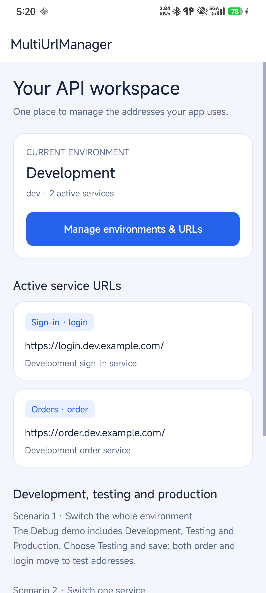
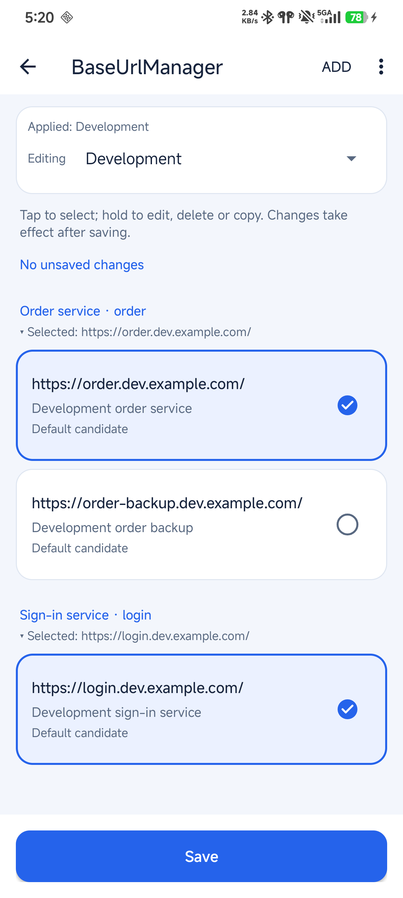
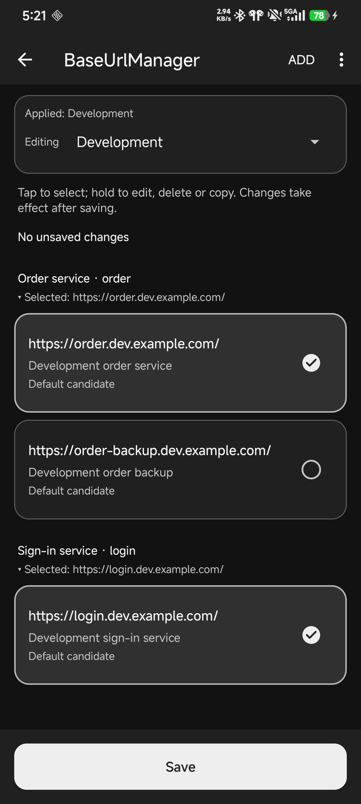

# MultiUrlManager

[中文](README.md) · [Documentation](docs/README.md) · [Changelog](CHANGELOG.md) · [1.3.0 Release](https://github.com/logan0817/MultiUrlManager/releases/tag/v1.3.0)

**Switch development, testing and production environments in your Android app, with separate server addresses for each service.** Use the built-in screen to choose addresses and save the entire configuration together. Selections survive app restarts.

For example, your app calls both order and sign-in services. Switch to development to change both at once, or select a backup for the order service while leaving sign-in unchanged.

The current stable version is **1.3.0**, available from Maven Central. The core has no Retrofit or OkHttp dependency. This release adds JSON file import/export and change previews, and fixes reliability issues in default configuration upgrades and editing.

Exchange configuration files with teammates through the system file picker, using merge by default or replacing selected environments. See [team configuration exchange](#exchange-team-configurations).

## Start here

- **First integration**: follow the [quick start](#quick-start) to configure, initialize, open the screen and verify a switch.
- **Existing Retrofit / OkHttp app**: complete core setup, then choose [how requests use new URLs](#make-network-requests-use-new-urls).
- **Production-only release**: see [fixed environment mode](#fix-release-builds-to-production).
- **Upgrading**: read [upgrade notes](#upgrade-from-an-older-version); initial defaults do not simply overwrite saved selections.

### Three concepts to know

| Concept | Example | Purpose |
| --- | --- | --- |
| Environment | `production`, `dev` | A complete set of server addresses, such as production or development |
| Service key (`configKey`) | `order`, `login` | The string your code uses to look up a service URL; it is not an environment name |
| Candidate URL | Main and backup order URLs | Several candidates can exist per service per environment, with at most one selected |

A base URL is the shared address prefix for API calls, such as `https://order.example.com/api/`. Your networking code adds endpoint paths such as `orders/42`. **The core manages URLs; it does not automatically update existing Retrofit / OkHttp objects.**

## Screenshots

The demo dashboard, editor and dark editor, captured on an Android 16 physical device. The demo shows configuration and interaction; the example domains do not provide real APIs.

<p>
  
  
  
</p>

Tap a candidate to select it; long press to edit, delete or copy. **Add** opens the URL form. **Reset** only restores the current environment's defaults in the draft; press **Save** to apply them.

## Quick start

These steps use **Kotlin + Gradle Kotlin DSL** and an app module named `app`. Merge changes into existing files; preserve your Application, Manifest and Gradle configuration.

Distinguish device support from build requirements:

| Setting | Check before integrating |
| --- | --- |
| `minSdk` | Your app must require **24** or higher (Android 7.0); this controls which devices can install it |
| `compileSdk` | Current transitive dependencies require **at least 35**; this is the SDK used to compile, not the device's Android version |
| Android Gradle Plugin (AGP) | Current transitive dependency metadata requires **at least 8.6.0** |
| JDK / bytecode | This repository uses **JDK 17**; the library publishes Java 17 bytecode |

**Verified combination: JDK 17, Gradle 8.14.3, AGP 8.13.0, Kotlin 1.9.23 and compileSdk 36.** Metadata minimums do not mean every version combination has been tested. If an older project fails at `checkDebugAarMetadata`, check `compileSdk` and AGP instead of only changing `minSdk`. See [development](docs/development.md#工程与工具链) for project build configuration.

### 1. Add dependencies

In the root `settings.gradle.kts`, make sure these repositories are available:

```kotlin
dependencyResolutionManagement {
    repositories {
        google()
        mavenCentral()
    }
}
```

Add the core dependency to `app/build.gradle.kts`, then run **Sync Project with Gradle Files** in Android Studio:

```kotlin
dependencies {
    implementation("io.github.logan0817:multiurlmanager:1.3.0")
}
```

Start with the core; it includes the built-in editor. Add the [optional networking artifact](#make-network-requests-use-new-urls) if you need automatic routing. Both artifacts are available directly from Maven Central.

### 2. Create the URL configuration

Create `base_urls_config.json` inside `app/src/main/assets/`, creating the `assets` directory if needed. Keep this exact filename. Copy the complete example and replace the URLs with your own:

```json
{
  "schemaVersion": 1,
  "defaultEnvironment": "production",
  "businessNames": {"order": "Order service", "login": "Sign-in service"},
  "environments": [
    {
      "id": "production",
      "name": "Production",
      "requiredKeys": ["order", "login"],
      "urls": [
        {"configKey": "order", "url": "https://order.example.com/", "select": true, "remark": "Production order service"},
        {"configKey": "login", "url": "https://login.example.com/", "select": true, "remark": "Production sign-in service"}
      ]
    },
    {
      "id": "dev",
      "name": "Development",
      "requiredKeys": ["order", "login"],
      "urls": [
        {"configKey": "order", "url": "https://order.dev.example.com/", "select": true, "remark": "Development order service"},
        {"configKey": "order", "url": "https://order-backup.dev.example.com/", "select": false, "remark": "Development order backup"},
        {"configKey": "login", "url": "https://login.dev.example.com/", "select": true, "remark": "Development sign-in service"}
      ]
    }
  ]
}
```

This defines production and development environments, each with order and sign-in services. Start with these fields:

| Field | What to enter |
| --- | --- |
| `schemaVersion` | Use `1`, the configuration format version, which differs from library version `1.3.0` |
| `defaultEnvironment` | Environment id for first use; `production` here, or `dev` to default new installations to development |
| `id` / `name` | Stable environment id / display name; ids must be unique and references must match |
| `businessNames` | Optional display-name mapping; show `order` as Order service in the editor while code still uses `order` |
| `configKey` | Service key; use the same string in code, such as `getUrl("order")` |
| `select` | `true` selects a default candidate; at most one per service per environment |
| `requiredKeys` | Services that must have a selection when saving this environment; both order and sign-in are required here |
| `remark` | Optional note to distinguish main and backup URLs |

**Existing installations preserve saved selections first.** Changing `defaultEnvironment` does not force the device to switch environments. The reserved `example.com` domains are for illustration and cannot verify real API availability.

URLs must use HTTP(S) and cannot contain credentials, query strings (`?…`) or fragments (`#…`). Include the trailing `/`; the core also adds it automatically. Unknown format versions, duplicate candidates or multiple selections per service fail explicitly. The AAR contains an empty compatibility configuration: omitting the host JSON can therefore show empty environments instead of failing initialization. Check the host assets file; successful initialization alone does not prove service URLs are configured. See [configuration](docs/configuration.md) for full rules.

### 3. Initialize once in Application

Create `App.kt`. Replace the sample package `com.example.demo` with your own. If your app already has an Application, add the initialization to its existing `onCreate()` instead of creating another one.

```kotlin
package com.example.demo

import android.app.Application
import com.logan.multiurlmanager.library.BaseUrlManager

class App : Application() {
    override fun onCreate() {
        super.onCreate()
        BaseUrlManager.builder(this).build()
    }
}
```

Set `android:name` on the existing `<application>` in `app/src/main/AndroidManifest.xml`:

```xml
<manifest xmlns:android="http://schemas.android.com/apk/res/android">
    <application
        android:name="com.example.demo.App" />
</manifest>
```

Initialize once per process. Initialization reads packaged definitions and persisted state and may access disk; do not repeat it for each request or page refresh. Reinitializing with different definitions fails. `BaseUrlManager.instance` is `null` before initialization.

### 4. Read URLs and confirm configuration loaded

Create `UrlReader.kt` in the same sample package. This function prints the current environment and addresses to Logcat; step 5 calls it from your existing screen:

```kotlin
package com.example.demo

import android.util.Log
import com.logan.multiurlmanager.library.BaseUrlManager

fun printCurrentUrls() {
    val manager = checkNotNull(BaseUrlManager.instance) { "Initialize BaseUrlManager in Application first" }
    val snapshot = manager.snapshot()
    val urls = snapshot.effectiveUrls()
    Log.d("MultiUrlDemo", "environment=${snapshot.environmentId}")
    Log.d("MultiUrlDemo", "order=${urls["order"]}")
    Log.d("MultiUrlDemo", "login=${urls["login"]}")
}
```

For one service, use `manager.getUrl("order")`; it returns `null` without a selection. This example uses `snapshot()` to read a complete mapping from a single revision, avoiding separate lookups across concurrent saves. Call it after Application initialization.

On a fresh installation with the original sample configuration, filter Logcat by `MultiUrlDemo` to see:

```text
environment=production
order=https://order.example.com/
login=https://login.example.com/
```

### 5. Open the editor from an existing screen

Call this line from a button click handler in your existing Activity; `this` must refer to that Activity:

```kotlin
startActivity(android.content.Intent(this, com.logan.multiurlmanager.library.BaseUrlManagerActivity::class.java))
```

The library editor is already registered through Manifest merging and has its own theme. Simply opening it requires no new entry Activity, extra AppCompat declaration or host theme change.

To check saved URLs, call the function from step 4 in your Activity's `onResume()`. If that method already exists, merge the call instead of declaring it twice:

```kotlin
override fun onResume() {
    super.onResume()
    printCurrentUrls()
}
```

Use the same package for `UrlReader.kt` and your Activity, or import `printCurrentUrls`. This prints active configuration on first entry and after returning from the editor. To distinguish saving from canceling and receive the result, see [receive editor save results](#receive-editor-save-results).

### 6. Verify a switch

1. Run the app and open the screen with your entry button. Filter Logcat by `MultiUrlDemo` and check the initial URLs from step 4.
2. Press your button to open the editor, select **Development**, then press **Save**. Changing the dropdown alone does not apply configuration.
3. On return, Logcat should show `dev`, order at `https://order.dev.example.com/`, and sign-in at `https://login.dev.example.com/`.
4. Reopen the editor, select the order backup and save. Order should become `https://order-backup.dev.example.com/`, with sign-in unchanged.
5. Close and restart the app, then return to the entry screen to confirm your selections remain.

If you replaced the sample URLs, compare with your own addresses. Canceling or discarding a draft leaves active configuration unchanged; edits apply only after a successful save.

URL management is now verified. Next, pass these addresses to your network layer as needed.

## Make network requests use new URLs

| Integration | What happens after saving |
| --- | --- |
| Core only, creating Retrofit or other networking objects yourself | Read effective URLs in a listener or screen result callback, rebuild affected services and replace their references; see the [listener example](#observe-configuration-changes) |
| Optional OkHttp routing | Configure `UrlRoutingInterceptor`, source base URLs and `RouteKey`; subsequent managed calls read saved URLs when entering the interceptor, without rebuilding services |

For the second option, add this alongside the core dependency:

```kotlin
dependencies {
    implementation("io.github.logan0817:multiurlmanager-okhttp:1.3.0")
}
```

**Adding the dependency is only the first step.** Follow the [routing integration guide](docs/network-routing.md) to configure the interceptor and request tags. Requests without `RouteKey` remain unchanged. The host must declare `INTERNET` permission for networking and its own Retrofit dependency.

Calls that have already entered the routing interceptor retain their original configuration. With either approach, the host manages cross-environment tokens, cookies, sessions, databases and caches. When using routing, register authentication after routing and choose credentials using that call's `RouteContext`, as described in the guide.

## Fix release builds to production

The default environment controls only the initial selection. A common setup is **switchable Debug builds and production-only Release builds**: the host checks its own build flag before enabling fixed mode.

This is an alternative to the Application from step 3. Set the Manifest's `android:name` to `com.example.demo.ReleaseAwareApp` (using your actual package), or merge the initialization inside `onCreate()` into your existing Application. Initialize only once:

```kotlin
package com.example.demo

import android.app.Application
import com.example.demo.BuildConfig
import com.logan.multiurlmanager.library.BaseUrlManager

class ReleaseAwareApp : Application() {
    override fun onCreate() {
        super.onCreate()
        BaseUrlManager.builder(this).apply {
            if (!BuildConfig.DEBUG) {
                setFixedEnvironment("production")
            }
        }.build()
    }
}
```

`BuildConfig` must come from the **host app's namespace**. Adjust the import if Application is in a subpackage; do not import the library's BuildConfig. If your app does not generate it, enable this in the `android` block of `app/build.gradle.kts`:

```kotlin
android {
    buildFeatures {
        buildConfig = true
    }
}
```

This example uses the host's `BuildConfig.DEBUG`; adjust the condition for custom build types. To fix all builds, remove the `if` and call `setFixedEnvironment("production")` directly. The library does not infer Debug / Release itself.

Fixed mode uses only that environment's packaged definitions; `production` must exist. The editor is read-only, and previously saved debug state is neither read nor overwritten. A later process using ordinary mode can restore those selections. **If a service has no selected URL in fixed mode, `getBaseUrl(key, fallback)` throws instead of using fallback.** Define required services in the packaged configuration or handle the `null` returned by `getUrl(key)`.

To package only production definitions in the Release APK, also place a complete production-only JSON in `app/src/release/assets/base_urls_config.json`. It replaces the entire main asset rather than merging environment arrays. In ordinary mode, this override alone still preserves saved device selections. Fixed mode does not remove test addresses from other source code; see [configuration and packaging](docs/configuration.md#debug--release-打包使用哪份配置).

## Exchange team configurations

Available starting with 1.3.0. The system file picker needs no camera or storage permission:

1. On the sending device, choose **Export configuration**, select environments, and save JSON. Export contains committed state, not the current draft.
2. On the receiving device, choose **Import configuration**, open the file, select environments, and choose **Merge** or **Replace selected environments**.
3. Review additions, removals, remarks and selections. Confirmation updates only the draft; press **Save** to apply it.

Merge preserves local selections by default. Replacement preserves the host's required service constraints. New environments are allowed, but unknown service keys are rejected and the active environment does not switch automatically. Fixed mode can export only its fixed configuration.

See the [team configuration file](docs/examples/team-development.json) and [full workflow, limits and errors](docs/configuration-transfer.md). Invalid or oversized imports never partially apply; existing state and draft remain intact.

## Optional advanced usage

Choose the task you need next:

| I want to… | Read this |
| --- | --- |
| Know what was saved or whether the user canceled | [Receive editor save results](#receive-editor-save-results) |
| Switch environments in code without opening the editor | [Edit and save from code](#edit-and-save-from-code) |
| Update my networking objects after URLs change | [Observe configuration changes](#observe-configuration-changes) |
| Reuse a Retrofit Service and route calls after saving | [Complete routing example](docs/network-routing.md#2-创建可发送请求的示例页面) |
| Allow switching in Debug and fix Release to production | [Fixed environment initialization](#fix-release-builds-to-production) |
| Change screen colors | [Customize the theme](#customize-the-screen-theme) |

See [configuration](docs/configuration.md) and the [API reference](docs/api.md) for complete contracts.

### Receive editor save results

<details>
<summary>Show complete Activity Result integration</summary>

To receive a save result on return, use this button screen with `AppCompatActivity`. Explicitly add AppCompat to `app/build.gradle.kts`; retain an existing compatible version if already declared:

```kotlin
dependencies {
    implementation("androidx.appcompat:appcompat:1.7.1")
}
```

Create `SettingsEntryActivity.kt` in the same package as `UrlReader.kt`. It prints the active configuration when opened and after returning from a successful save:

```kotlin
package com.example.demo

import android.os.Bundle
import android.widget.Button
import android.widget.Toast
import androidx.appcompat.app.AppCompatActivity
import com.logan.multiurlmanager.library.BaseUrlManagerContract

class SettingsEntryActivity : AppCompatActivity() {
    private val settings = registerForActivityResult(BaseUrlManagerContract()) { result ->
        if (result != null) {
            printCurrentUrls()
            Toast.makeText(
                this,
                "Environment: ${result.environmentId}; changed: ${result.changed}",
                Toast.LENGTH_SHORT
            ).show()
        }
    }

    override fun onCreate(savedInstanceState: Bundle?) {
        super.onCreate(savedInstanceState)
        printCurrentUrls()
        setContentView(Button(this).apply {
            text = "Manage base URLs"
            setOnClickListener { settings.launch(null) }
        })
    }
}
```

Add this **sample entry Activity** inside your existing Manifest's `<application>`. The theme applies only to this entry; the library editor is already registered automatically:

```xml
<manifest xmlns:android="http://schemas.android.com/apk/res/android">
    <application>
        <activity
            android:name="com.example.demo.SettingsEntryActivity"
            android:theme="@style/Theme.AppCompat.DayNight.NoActionBar"
            android:exported="false" />
    </application>
</manifest>
```

From a button or developer menu in your existing Activity, run this line to open the sample entry (replace the package with your actual package):

```kotlin
startActivity(android.content.Intent(this, com.example.demo.SettingsEntryActivity::class.java))
```

An existing `ComponentActivity` or AndroidX `Fragment` can register `BaseUrlManagerContract` directly without changing base classes; explicitly declare the Activity/Fragment dependencies your code uses.

Cancel returns `null`. A successful save returns `BaseUrlManagerResult`, with `environmentId`, `revision`, `changed` and the current environment's selected `urls`. `changed` can also reflect edits to unselected candidates, so it alone does not imply a different network target.

</details>

### Edit and save from code

Use `saveAsync` on the UI thread: the library writes on its background queue and delivers the callback on the main thread. This example switches a snapshot to the configured production environment and handles save failures:

<details>
<summary>Show complete save example and failure handling</summary>

```kotlin
import android.content.Context
import android.widget.Toast
import com.logan.multiurlmanager.library.BaseUrlManager
import com.logan.multiurlmanager.library.SaveResult

fun selectProduction(context: Context) {
    val manager = checkNotNull(BaseUrlManager.instance)
    val draft = manager.snapshot().copy(environmentId = "production")
    manager.saveAsync(draft) { result ->
        val message = when (result) {
            is SaveResult.Success ->
                "Saved ${result.snapshot.environmentId}; changed: ${result.changed}"
            is SaveResult.Failure -> when (result.reason) {
                SaveResult.Reason.VALIDATION -> "Invalid configuration: ${result.message}"
                SaveResult.Reason.CONFLICT -> "Configuration changed. Reload before editing again."
                SaveResult.Reason.STORAGE -> "Storage failed. Confirm stored state before retrying."
            }
        }
        Toast.makeText(context, message, Toast.LENGTH_LONG).show()
    }
}
```

- **VALIDATION**: correct the URL, required service selection or environment information before saving again.
- **CONFLICT**: the draft revision is stale. Preserve user input, read a fresh snapshot and ask the user to confirm any merge instead of overwriting newer state.
- **STORAGE**: the write outcome is uncertain and subsequent writes are blocked. Successfully call `refreshData()` on a background thread to confirm persisted state, or restart and confirm it before editing again. The built-in screen offers Reload; a failed read preserves the draft and protection state.

An unchanged save returns `Success(changed=false)`. Synchronous `save`, `select`, `switchEnvironment`, `restoreDefaults` and legacy write APIs access disk and belong on a background thread. Legacy write methods throw on failure.

</details>

### Observe configuration changes

Listeners receive complete before/after snapshots on the main thread in commit order, only when the current environment or effective mapping changes. This object maintains a current mapping; connect your network factory in the listener as needed:

<details>
<summary>Show listener registration and cleanup example</summary>

```kotlin
import com.logan.multiurlmanager.library.BaseUrlManager
import com.logan.multiurlmanager.library.UrlChangeListener
import java.io.Closeable

class ActiveUrls(private val manager: BaseUrlManager) : Closeable {
    @Volatile
    var urls: Map<String, String> = manager.snapshot().effectiveUrls()
        private set

    private val listener = UrlChangeListener { _, current ->
        urls = current.effectiveUrls()
    }

    init {
        manager.addListener(listener)
        urls = manager.snapshot().effectiveUrls()
    }

    override fun close() {
        manager.removeListener(listener)
    }
}
```

Create the object when its owner begins observing and call `close()` when that lifecycle ends. An Activity observing only while visible can create it in `onStart()` and close it in `onStop()`; an application-level network factory can retain it for its lifetime. Registration does not replay current state, so the example explicitly reads a snapshot.

This object updates only the URL mapping. With the core alone, the host must also rebuild changed services and replace references; in-flight requests retain their original URL. The compiled [network integration example](app/src/main/java/com/logan/multiurlmanager/NetworkIntegrationExample.kt) demonstrates service replacement. See [UI and network behavior](docs/ui-and-network.md).

</details>

### Common APIs

| API | Purpose |
| --- | --- |
| `builder(context).build()` | Initialize from packaged JSON; `setEnvironments` / `setDefaultProvider` are also supported |
| `getUrl(key)` / `getBaseUrl(key, fallback)` | Read a selection; ordinary mode permits explicit, non-persisted fallback; fixed mode forbids fallback when no URL is selected |
| `snapshot()` / `snapshot().effectiveUrls()` | Read isolated complete state / the current environment's effective mapping |
| `saveAsync(snapshot, callback)` | Persist on a background queue, with a complete result on the main thread |
| `save(snapshot)` | Synchronously commit with revision, validation and storage checks |
| `select(key, url)` / `switchEnvironment(id)` | Synchronous convenience commits returning `SaveResult` |
| `restoreDefaults()` | Synchronously restore current-environment defaults |
| `defaultEnvironment(id)` | Read a copy of an environment's defaults without changing active state |
| `addListener` / `removeListener` | Subscribe / unsubscribe to effective configuration changes |
| `BaseUrlManagerContract` | Activity Result entry point for the built-in screen |

See the [Java example](app/src/main/java/com/logan/multiurlmanager/JavaIntegrationExample.java) for Java calls. The library targets **single-process** configuration management and does not synchronize writes across processes.

### Customize the screen theme

<details>
<summary>Show theme and Manifest configuration</summary>

In the host's `res/values/styles.xml`, inherit the library theme:

```xml
<resources>
    <style name="AppUrlManagerTheme" parent="BaseUrlManagerTheme">
        <item name="base_url_toolbar_bg_color">#EEF2FF</item>
        <item name="base_url_page_title_text_color">#172554</item>
    </style>
</resources>
```

Override the library Activity's theme in the host manifest:

```xml
<manifest xmlns:android="http://schemas.android.com/apk/res/android"
    xmlns:tools="http://schemas.android.com/tools">
    <application>
        <activity
            android:name="com.logan.multiurlmanager.library.BaseUrlManagerActivity"
            android:theme="@style/AppUrlManagerTheme"
            tools:replace="android:theme" />
    </application>
</manifest>
```

Provide matching dark colors in `values-night`. The status-bar safe area and toolbar share `base_url_toolbar_bg_color`; system-bar icons adapt to the actual background. See [attrs.xml](library-android/src/main/res/values/attrs.xml) for all attributes. Existing `base_url_btn_add_*` names now style the bottom Save button, preserving theme compatibility.

</details>

## Upgrade from an older version

Upgrading from 1.2.0 to 1.3.0 preserves saved selections and custom URLs. JSON with `schemaVersion` now requires exact field types: use actual booleans and integers rather than strings. Legacy array configurations and persisted data remain readable. When default updates change the effective configuration, a restored older draft reports a revision conflict; reload before editing again.

Ordinary mode also preserves saved selections when upgrading from 1.1.x. Fixed mode requires explicit host opt-in. See the [changelog](CHANGELOG.md) for the full changes.

When upgrading from 1.0.x, valid saved addresses move into the active `legacy` environment (or an available id such as `legacy-1` on a name conflict), initially keeping the old addresses. New defaults do not overwrite selections or rename service keys. Legacy array JSON, `setFileConfigKey` and Activity result parsing remain supported; `dynamicUrls` now returns a copy, so mutating it no longer updates configuration.

Read [migration](docs/migration-1.1.md) before upgrading for state ownership, default updates, backups and downgrade limits. Do not hide migration issues by clearing user data.

## Common questions

| Symptom | Check first |
| --- | --- |
| `instance` is `null` | Application registration in the Manifest, and whether initialization succeeded |
| The editor switches, but requests do not | Save first; core integration must update networking objects, while routing requires correct tags and interceptor setup |
| Editing JSON still shows the old environment | Ordinary mode preserves selections; `defaultEnvironment` controls the initial default only |
| Save reports an error or conflict | Inspect the reason, required selections and stale drafts; preserve input before reloading if needed |
| The editor is read-only | Check `setFixedEnvironment`; fixed mode prevents editing and switching |

See [troubleshooting](TROUBLESHOOTING.md) for more diagnostics.

## More documentation and contributing

Detailed reference pages are currently maintained in Chinese:

| Topic | Contents |
| --- | --- |
| [Configuration](docs/configuration.md) | JSON, service display names, code definitions, fixed mode, source sets and default updates |
| [Network routing](docs/network-routing.md) | Optional OkHttp / Retrofit integration, switch timing and authentication boundaries |
| [API](docs/api.md) | Snapshots, saving, threads, listeners, Java and compatibility boundaries |
| [UI and network](docs/ui-and-network.md) | Drafts, change summaries, themes, results and when network changes take effect |
| [Migration](docs/migration-1.1.md) | Legacy state, default merging, backups and downgrade limits |
| [Development](docs/development.md) | Toolchain, tests and real AAR / R8 consumption |
| [CI and releases](docs/ci-and-release.md) | Required checks, artifact signatures, publication and recovery |
| [Contributing](CONTRIBUTING.md) / [Changelog](CHANGELOG.md) | Contribution requirements and version changes |

When reporting an issue, include the library version, Android version, build type, sanitized configuration, reproduction steps and logs. Do not include keys, real tokens or private service credentials. Bug and feature-request templates are available.

Based on [jenly1314/BaseUrlManager](https://github.com/jenly1314/BaseUrlManager), extended for multiple services and environments. Licensed under [MIT](LICENSE).
