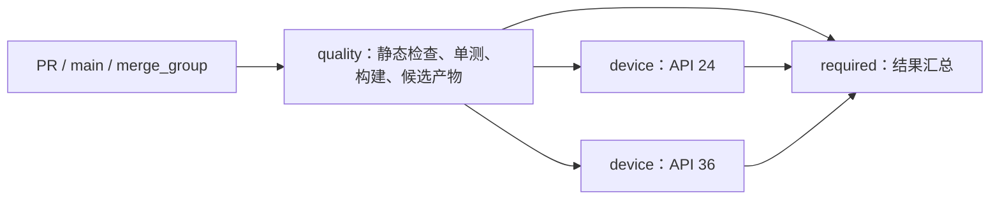

# MultiUrlManager 1.1.0 实现方案

日期：2026-10-16
状态：开发实现已落地，本地源码与文档审核及 API 24/36 验证通过；云端 CI 和正式发布仍待验收。本文保留设计目标，实际 API 以 [API 文档](../api.md) 和源码为准。未勾选验收项代表尚未取得完整证据，不因已有实现而视为通过。
基线：实施前工作区 `main`，提交 `801d130`；实施前声明版本 `1.0.6`，实施阶段开发版本 `1.1.0-SNAPSHOT`。已另行取得 Maven Central 真实 `1.0.6` AAR 建立公开 ABI 基线，不把源码提交等同于发行二进制。

## 当前实施与验证记录

- 2026-10-19 提交前审查修复两项数据缺陷、主题测试隔离与 CI/发布校验缺口。最终本地 JVM 23 项、Python 29 项、API 24 页面 14 项/存储 16 项/R8 1 项、Debug/Release 覆盖升级各 9 个阶段通过；新输入的 API 36 验证等待云端矩阵。

- 2026-10-16 发布前整理：README 已包含完整接入与调用示例；核心/页面/模型/示例及 Gradle 配置整理格式和关键中文注释，并修复默认必选集合泄漏、legacy 迁移冲突及 schema 版本强制转换。最终 JVM 22 项、API 24 页面 14 项/存储 13 项/R8 消费 1 项、脚本 21 项通过，10 份 README Kotlin 示例实际编译。此前旧 APK asset/代码路径检查不等于覆盖升级；2026-10-19 增加真实发行 AAR 覆盖升级夹具，最终证据见开发验收记录。当前门槛与限制以 [发布前本地审核记录](../development.md#发布前本地审核记录) 为准。
- 本轮 API 36 真机最终页面 14 项、存储 12 项、独立 R8 消费 1 项通过。消费测试先被系统后台弹出权限拦截；用户允许后，相同 APK 在 2.74 秒内通过。Demo 配置已逐字节恢复，后续消费测试未改变 Demo 配置。
- 参考同账户 KToast、FlowBus，补充主分支独立 CI 并发组、离线 publication/项目批次检查、本机 GPG 签名包、完整指纹选钥验签，以及默认仅上传、显式正式发布的两个阶段。当前脚本 21 项通过；云端与正式发布仍未执行。以下内容保留较早阶段记录。

- 已建立中英文接入入口、配置/API/迁移/开发/排障/CI发布文档、JSON Schema 与贡献模板。
- 已实现 quality/device/required 工作流、API 24/36 矩阵、同轮候选 manifest、仪器输出解析与手动受控发布。
- 辅助脚本本地 10 项行为测试通过；覆盖失败/崩溃/零用例/截断、错误候选身份/摘要/路径、正式发布文件与可信 main CI 来源、恢复部署内容不匹配。
- 两个工作流通过 actionlint 1.7.7 静态检查；13 份文档及本地 JSON/链接检查通过。
- Actions 完整 SHA、setup-gradle v6 basic 参数、模拟器 action 参数已核对固定提交的官方 action.yml；Google SDK 仓库包含 API 24/36 的 google_apis x86_64 镜像。
- 已通过 13 个 JVM 测试，API 24 页面 6 个、存储 9 个设备测试；API 36 尚未执行。
- 已核验真实已发布 1.0.6 AAR 的固定 SHA-256，公开 ABI 覆盖 17 类、105 个字段/方法，与当前 Release AAR 对比通过；CI 已接入该门槛。
- 已使用真实 app/library/consumer APK 和本地 Maven 文件生成完整候选，身份与逐文件摘要集成校验通过；此项不代表 R8 设备执行通过。
- R8 消费在 API 24 上通过 1 个设备用例，覆盖持久化重读和管理页打开；最终候选通过 CI 设备脚本执行 app/library/consumer 三套完整终态校验。未执行云端 CI、缓存冷热/fork/取消/merge_group 演练、分支保护与 release environment 配置、Central 上传或正式发布。

## 1. 版本目标与范围

将框架完善为可可靠接入的 Android 多业务域名配置工具：配置操作有一致的规则，多个域名可以按环境一起切换，用户编辑可以保存或取消，升级能够保留已有数据，并有可执行的文档、测试、CI 和发布流程。

建议下一版本为 `1.1.0`，分阶段完成后统一发布。若需要先交付现有缺陷修复，可以从第一阶段形成 `1.0.7`，但不把后续能力写入其发布说明。

| 范围 | 本版本交付 |
| --- | --- |
| 核心行为 | 分组单选、统一校验、批量操作、错误反馈、线程与初始化约定 |
| 环境能力 | 环境与业务键分离、整组切换、环境内自定义覆盖、恢复默认 |
| 数据 | 持久化快照、旧数据迁移、损坏处理、升级及回退说明 |
| 页面 | 编辑草稿、保存与取消、地址增删改、环境选择、状态恢复、中英文提示 |
| 接入 | 旧 API 兼容、新结果 API、变更通知、Activity Result API、网络接入示例 |
| 工程 | 可复现工具链、有效测试、Release 消费验证、依赖与发布配置整理 |
| 文档 | 重写中英文入口、配置/API/迁移/贡献/CI/发布文档、示例和更新记录 |
| 自动化 | PR 与主分支检查、设备测试、稳定汇总检查、受控发布与产物追溯 |

本版本继续面向单进程、少量环境、每个环境十几个业务键的调试场景。保持 `app` 与 `library-android` 两个主模块，不引入远程配置服务、数据库、多进程同步、Compose 重写或网络请求代理框架。网络层先提供独立示例，核心库不依赖 Retrofit 或 OkHttp。

## 2. 已确认基线与缺口

| 现状 | 依据或验证 | 对本版本的影响 |
| --- | --- | --- |
| 同一键可通过 API 写入多个选中地址 | `BaseUrlManager.addBaseURL()` 只去重相同键和 URL | 单选约束必须进入核心层 |
| 新增地址会覆盖页面未保存的选择 | 页面使用副本选择，新增后重新从管理器构建列表 | 编辑操作统一使用草稿 |
| 全量更新先清空，再逐条同步写入 | `updateBaseURL()` 与 `BaseUrlUtil.put()` | 需要整体保存与失败反馈 |
| 配置只在整个存储为空时加载 | `refreshData()` | 新增默认业务键无法自然补齐 |
| 默认环境取自库的 `BuildConfig.DEBUG` | `BaseUrlConfigLoader` | 改为宿主显式选择环境 |
| URL 校验仅发生在页面 | 核心 API 仅检查空白，页面正则还接受 ftp/file | 页面、API 和 JSON 共享校验规则 |
| 测试存在模板残留 | 应用仪器测试引用阶乘计算控件；实际编译报 `Unresolved reference: R` | 测试修复是实施第一阶段的交付物 |
| Debug 构建已通过 | 本次会话先前执行两个模块的 `assembleDebug` 成功 | 只能作为当前编译基线，不能代替功能与 Release 验证 |
| 仓库未检出 CI 文件 | 当前已跟踪文件中没有 `.github/workflows` 等工作流 | 按新建 CI 设计；远端分支规则与历史运行未核验 |
| 发布配置不完整 | 版本目录声明发布插件，但模块未应用，也未配置 publication | 补齐本地发布候选和正式发布流程 |
| 文档有失效内容 | Java/Kotlin 混写、`find` 中赋值、旧模板排障说明、引用未检出的 GIF | 以可编译示例重建文档 |
| 本机配置被跟踪 | `local.properties` 在 `.gitignore` 中但仍被 Git 跟踪 | 实施时从版本索引移除，保留开发者本地文件 |

上表描述方案制定时的历史基线；本轮已取得的 ABI、JVM 与 API 24 证据见顶部实施记录。Release 混淆、API 36 与云端运行仍须分别取得证据，不能因实现已存在而视为通过。

## 3. 核心行为设计

### 3.1 数据与环境模型

将两个概念分开：

- `environmentId`：开发、测试、预发等环境的稳定标识；显示名称可以修改。
- `configKey`：登录、订单、文件服务等业务标识；在各环境间保持一致。

每个环境包含业务键的候选地址与当前选择。保存的状态包含当前环境、各环境的用户覆盖和历史地址。运行时先解析默认配置，再应用当前环境的用户覆盖，得到完整的有效映射。

新增环境定义与内部持久化 DTO，不给已有 `BaseUrl` 构造函数直接增加必填参数。保留 `configKey` 的原始大小写；去掉输入两端空白，不擅自折叠不同业务键。

### 3.2 一致性规则

1. 同一环境内，同一 `configKey` 最多有一个选中地址。
2. 新增非选中候选，不改变当前选择。显式选择一个候选时，取消该键的其他选择。
3. 单条更新中显式 `select=true` 表示选择该地址。批量导入或新 JSON 中同组多选直接返回校验错误，避免依赖遍历顺序。
4. 重复的环境、键、规范化 URL 视为同一候选，更新备注而不新增重复项；新增表单不得把现有选中项意外改成未选中。
5. 删除选中地址后，该键进入“未选择”状态，不静默选中另一台服务器。必须有值的业务键阻止保存，要求用户明确选择。
6. 无选择的可选业务键返回空；只有调用方明确传入 fallback 时才使用 fallback，并且不自动持久化它。
7. `clear()` 表示清空用户数据；恢复默认是单独操作。避免 `clear()` 后下一次读取又隐式写回默认历史的混乱语义。旧方法的行为变化写入迁移说明。
8. 一次整组切换对外发布一个完整状态；观察者不会看到登录已切换、订单尚未切换的中间映射。

默认配置增加 `required` 业务键声明。旧配置中的键默认仍为可选，避免升级后突然无法保存；示例项目将核心业务键显式标记为必需。

### 3.3 默认配置与覆盖优先级

有效地址按“当前环境的用户选择 > 当前环境的默认选择 > 调用方显式 fallback”解析。不同环境的自定义覆盖互不混用。

- 宿主通过 Builder 显式传入默认环境；不读取库自己的 `BuildConfig.DEBUG` 推断宿主环境。
- 旧 `setFileConfigKey()` 继续映射到对应配置组。未显式设置时保留兼容入口并给出可诊断提示，新示例一律显式配置。
- 代码配置优先于 JSON。必须区分“没有提供 provider”和“provider 明确返回空集合”；空集合不偷偷回退 JSON。
- 新版本新增默认业务键时补齐缺失项，保留已有用户选择。
- 默认地址被维护者修改时，未被用户覆盖的键跟随更新；已覆盖的键保留原选择并标明来源。
- 默认项被删除时，保留用户创建的候选；失去默认定义的历史项标记为自定义，不静默删除用户数据。
- 切换环境保留各环境内的覆盖。页面明确提供“恢复此环境默认值”；完整清空另设确认操作。

旧 JSON 顶层 `debug_defaults`、`release_defaults` 及自定义键继续可读。新增带 `schemaVersion` 的环境格式，先写正式 schema 和示例，再实现解析器；未知 schema 版本明确拒绝，不能按空配置继续。

### 3.4 URL 与错误处理

统一校验入口用于代码、JSON、页面和迁移：

- HTTP(S) scheme、有效 host、端口范围、合法转义与路径；覆盖域名、IPv4、IPv6、本地调试地址。
- 不接受 URL 中的用户名密码、fragment；基础地址不接受 query，避免后续请求拼接语义不清。
- 保留路径和大小写语义，不做任意字符串替换。末尾 `/` 由新增 API 的标准化步骤补齐并在页面展示最终值；旧存量地址的变化必须通过迁移用例确认。
- 格式错误指出环境、业务键、字段和原因，不在默认日志打印完整私有地址或认证信息。
- 错误 JSON、缺失文件、缺失环境、字段错误、空配置是不同结果；调试时可定位，发布接入时可处理。
- 自定义正则仅作为额外约束，不能绕过基础解析。非法正则在入口检查并返回配置错误，不能等用户点击时崩溃。

使用标准解析能力；如果实现阶段证明标准能力不足，再评估依赖，不为 URL 校验给核心库加入整个网络栈。

### 3.5 API、线程和初始化

新增 API 的建议职责如下，名称在 API 基线评审时固定：

| 能力 | 拟新增接口职责 |
| --- | --- |
| 查询 | 获取不可变状态快照、当前环境、有效 URL 字符串与配置来源 |
| 编辑 | 显式选择、增删改候选、整体保存、切换环境、恢复当前环境默认 |
| 结果 | 区分成功、无变化、校验失败、存储失败、草稿冲突 |
| 观察 | 注册/移除配置变更监听，返回变更键、旧环境和新环境 |
| 页面接入 | Activity Result Contract，同时保留旧 requestCode 入口 |

内部只保留一个有效状态来源。所有新写入入口串行处理，成功持久化后再发布新快照和通知；只读查询读取最新已提交快照。保存操作不在 UI 主线程执行磁盘写入，页面显示保存中状态并防止重复提交。

通知在主线程按提交顺序派发，仅在有效状态变化时触发；一个批量修改只触发一次。提供移除监听入口，回调异常不影响已完成的保存，也不阻止其他观察者，但必须留下可诊断错误。当前版本不引入全局事件总线。

Builder 使用 applicationContext，线程安全地初始化一次。相同配置的重复初始化可复用；不同配置的重复初始化返回明确诊断，不只输出 `println`。多进程不属于支持范围，文档说明初始化和写入均应在宿主约定的单一进程内完成。

## 4. 持久化、迁移与兼容

### 4.1 持久化方案

建议将新增环境状态保存为一个版本化 JSON 快照，使用 Android 标准 `AtomicFile` 完成整文件替换。当前数据规模适合整体读写，不新增数据库或第三方存储依赖。

采用该方式的目的，是把环境、候选、当前选择和 schema 版本作为同一份提交保存；旧版逐条 SharedPreferences 写入由兼容入口统一转交给新存储。`BaseUrlUtil` 与管理器不能继续分别维护可写状态。

写入步骤为“复制输入 → 校验与归一化 → 检查草稿版本 → 序列化 → 原子写入成功 → 替换内存快照 → 发通知”。写入异常调用恢复路径，返回失败，保留上次有效状态。初始化发现未完成写入时按 `AtomicFile` 约定读取有效文件；行为通过故障注入和重启测试确认。

`AtomicFile` 不提供线程或进程锁，文件读写必须由同一存储组件串行保护。实现不能仅以 `finishWrite()` 返回作为成功证据：写入阶段显式检查同步错误，完成后核对可读快照的版本与摘要；无法确认结果时返回存储错误并阻止继续覆盖，保留可恢复数据。[Android AtomicFile 说明](https://developer.android.com/reference/android/util/AtomicFile.html)

DTO 为序列化字段固定名称，并提供最小 consumer R8 规则。未知字段可忽略，未知 schema 必须报错。不要依赖 Kotlin 非空类型阻止 Gson 反序列化出缺失字段。

### 4.2 从 1.0.x 迁移

1. 新状态文件不存在时，读取旧 `dynamic_base_urls_config`，先复制原始记录作为迁移备份；不先清空旧存储。
2. 每条记录独立解析、校验、去重；坏记录记录数量与键定位信息，不把一条错误扩大为全库清空。
3. 旧记录没有环境身份，导入独立的“历史配置”环境，并设为首次升级后的当前环境；不猜测其属于生产或测试。
4. 同组多选优先按旧管理器的时间升序选择第一项；时间相同用稳定 URL 排序决胜，记录修复诊断。不能可靠还原的歧义在迁移说明中明确。
5. 默认环境清单保留，用户后续显式切换即可使用；旧记录保留的 URL 不应因默认环境变化自动切换。
6. 一次性写入新快照；成功后才记录迁移完成。迁移重复执行须得到相同结果；失败不覆盖旧数据，下次可重试。
7. 全部旧记录无效时进入可见错误状态，由用户选择恢复默认，不能悄悄访问默认服务器。

回退限制：保留的旧存储只代表迁移前状态，旧版本不能理解新环境与升级后的编辑。降级前需通过明确的导出/转换步骤保存当前有效映射，或恢复迁移前备份；不能宣传任意版本无损双向迁移。正式发布前将这个限制写进迁移指南。

### 4.3 API 与发布兼容

- 保持 Maven 坐标 `io.github.logan0817:multiurlmanager`、现有包名和主要入口。
- 保持现有 `BaseUrl` 构造、Parcelable 和查询返回类型；新增 URL 字符串查询作为独立方法，不偷偷改变旧返回类型。
- 新功能优先添加到具体管理器或新接口，不直接给已有 `IBaseUrlManager` 增加必须实现的抽象方法，避免破坏外部实现。
- 旧同步写入方法保留签名，委托同一校验与存储路径；声明同步行为、失败异常和推荐替代接口，不能吞掉保存失败。
- 旧 `dynamicUrls` 及对象可变性属于风险接口。建议标记弃用，读取返回深拷贝；具体类现有 setter 保留并转交整体验证。直接修改 getter 返回列表不再改变管理器，这是有意的行为收紧，必须有迁移示例和发布说明。
- 对依赖“直接修改列表即改变查询结果”的接入方，提供显式保存迁移方法；不得声称这类用法完全行为兼容。如果真实消费者要求保持该行为，推迟这项收紧至主版本，不能在实现中悄悄折中。
- 在实施第一阶段取得真实已发布 AAR，建立公开 ABI 基线及 Kotlin/Java 消费样例。当前源码版本号不能代替发布二进制证据。

## 5. 管理页面与示例应用

页面持有独立编辑草稿，选择、新增、编辑、删除、切换环境和恢复默认都先修改草稿。点击保存执行一次完整提交；失败留在当前页面并保留输入。取消放弃草稿，有修改时提示；保存成功才返回 `RESULT_OK`。

草稿记录开始编辑时的状态版本。页面打开期间若其他调用方修改了配置，保存返回冲突并提示重新加载，避免覆盖最新状态。旋转和系统重建恢复草稿与当前环境；正在保存时重建不能重复提交。

页面交付包括：

- 环境选择与当前环境标识，按业务键分组，显示有效地址来源和自定义覆盖状态。
- 地址与备注增删改、复制地址；删除当前地址明确提示影响。
- 空配置、未初始化、校验失败、迁移失败、保存失败和保存中的可见状态。
- 输入错误放在对应字段附近；长域名可查看全文，选择控件有无障碍说明。
- 检查小屏、横屏、字体放大、深浅主题、键盘、手势导航与三键导航。
- 提示文字全部进入资源文件，中文和英文对齐；保留既有主题属性。

示例应用同时展示 JSON 和代码配置，但由单一明确入口选择一种方式。增加配置变更通知与网络生效示例：使用新映射重建受影响 Service，明确在途请求不会被追溯改址。切换环境涉及 token、cookie 和业务缓存时由宿主处理，框架不替宿主删除用户数据。

优先提供可编译的 Kotlin 示例，同时为公开 Java 入口提供编译测试。增加 Activity Result 新入口，保留旧入口的兼容示例。

## 6. 工具链与工程整理

| 项目 | 建议 |
| --- | --- |
| JDK | 统一使用 17，开发文档解释 Gradle JVM 与编译目标的区别 |
| Android 支持范围 | 保持 minSdk 24、compileSdk/targetSdk 36，本版本不扩大平台支持承诺 |
| AGP | 当前 8.6.0 与 API 36 的正式支持不匹配；选择官方支持 API 36 的稳定 8.x，先验证最小必要升级 |
| Gradle | 优先保留 Wrapper 8.14.3，核对所选 AGP/Kotlin 组合后再决定；补 Wrapper 分发校验和 |
| Kotlin/依赖 | 不整体追新；核验现有 Kotlin、RecyclerView alpha、Gson 与新 AGP 的兼容及维护情况，逐项固定版本 |
| 构建结构 | 保留版本目录；评估移除只用于注入插件依赖的 buildSrc，统一插件声明，收益不足则保留 |
| 本地配置 | 保留本机 SDK 配置，从版本控制移除 local.properties；不提交签名与账号配置 |
| Release | 增加真实开启 R8 的消费测试，补精确 consumer rules；不使用全包 keep 掩盖问题 |

Android 官方兼容表列出 API 36 的最低 AGP 为 8.9.1。这是本次升级的最低约束，不表示必须选这个旧补丁版本；实施时固定可用且通过验收的稳定版本，不能以压制 unsupported compileSdk 警告作为最终解决方式。[官方兼容说明](https://developer.android.com/build/releases/about-agp)

## 7. 测试与验收设计

### 7.1 测试分层

| 层次 | 必测行为 | 运行位置 |
| --- | --- | --- |
| JVM 行为测试 | 分组单选、批量冲突、重复项、选择删除、URL 标准化、环境优先级 | PR/主分支 |
| 存储与迁移测试 | 写入失败、截断文件、坏记录、旧版迁移、迁移幂等、重启读取 | 仪器测试；纯解析部分放 JVM |
| 页面测试 | 选择后新增、取消、重置后取消、保存失败、旋转恢复、并发编辑冲突 | API 24 与 API 36 |
| API 兼容 | 旧 Kotlin/Java 调用、公开 ABI 差异、Parcelable、旧 Intent 结果 | PR/主分支 |
| 发布消费 | 本轮 AAR/POM 依赖解析、R8 后反序列化、页面打开、配置读取 | 独立消费 fixture + 设备冒烟 |
| 文档与配置 | JSON 示例合法、文档示例可编译、内部链接、工作流静态检查 | PR/主分支 |

不设没有基线的覆盖率百分比。以行为清单作为门槛，所有写入、迁移和环境切换失败路径至少有一个能阻止回归的测试。

测试数据独立，前后清理自己创建的配置；不能依赖 Map 顺序、现有设备历史数据或外部真实网站。通过可替换的内部存储接口注入失败，这个接口只服务实际存储与测试，不扩展成任意插件系统。

### 7.2 关键验收场景

1. 同一键通过页面、代码、JSON 进入后，都满足同一单选规则。
2. 先选择、再新增或编辑地址，草稿选择不丢失；退出取消不产生持久化副作用。
3. 传入管理器返回的集合进行全量更新，不会先清空输入。
4. 10 个业务键一起切换环境，任何读取者和回调看到的都是完整旧映射或完整新映射。
5. 保存失败无成功结果和成功回调；重启读取上次有效数据，用户可重试。
6. 1.0.x 的正常数据、重复选择、部分坏记录都能得到确定迁移结果；原数据保留可恢复。
7. 新增默认键可见，用户覆盖不丢失；明确空 provider 不回退到其他来源。
8. release AAR 集成进 Debug 宿主时，环境由宿主设置决定。
9. API 24 与 API 36 的管理页可操作，导航栏与键盘不会遮住保存/新增入口。
10. R8 消费用例运行通过，普通构建成功不能替代这一项。

## 8. 文档重组

README 作为接入入口，详细约定各有唯一权威文档；避免把完整 API 和所有排障内容复制到多个位置。

| 文件（拟新增或重写） | 内容与验收 |
| --- | --- |
| `README.md` | 中文定位、截图、支持范围、依赖、最短可用示例、文档导航 |
| `README_EN.md` | 对应英文入口；版本、API 和行为与中文一致 |
| `docs/README.md` | 文档索引与阅读顺序，标明设计提案和已实现功能 |
| `docs/configuration.md` | 环境、业务键、JSON schema、代码 provider、优先级、校验和错误 |
| `docs/api.md` | 初始化、查询、写入结果、线程、监听、生命周期和 Java 接入 |
| `docs/ui-and-network.md` | 页面接入、主题、自定义入口、网络生效时机及宿主职责 |
| `docs/migration-1.1.md` | API 替换、存量数据、行为变化、备份、降级限制 |
| `docs/development.md` | JDK/SDK、构建、测试、模块结构、本机配置、常见维护操作 |
| `docs/ci-and-release.md` | 检查矩阵、产物、缓存、必需检查、发布流程、失败恢复 |
| `TROUBLESHOOTING.md` | 重写现有排障入口：初始化、配置未生效、持久化、SDK/JDK、R8 |
| `CONTRIBUTING.md` | 开发入口、验证要求、PR 范围、兼容性和文档要求 |
| `CHANGELOG.md` | 按真实发布记录新增、修复、兼容变化与迁移链接 |
| `.github` 模板 | 简洁 Bug/功能反馈模板、PR 验证与兼容性提示 |

示例以实际可编译源码和 JSON 为源。CI 校验文档摘录与源码一致；新增版本未发布前使用明确的开发版本说明，不能提前让用户依赖不存在的 Maven 版本。

替换失效截图、演示 APK 和 API 文档链接。截图放文档资源目录；演示 APK 放真实 Release 资产；没有可用产物时删除失效入口。保留 MIT 许可证与上游参考说明，核对复用代码的必要版权信息，不增加无关声明。

中文详细文档先完整落地，中英文 README 同步交付；英文入口明确标注详细文档语言，不提供过期的复制版本。发布前全文核对代码块语言、真实换行、链接、术语、默认值和版本。

## 9. CI 设计

### 9.1 触发与稳定检查入口

拟新增 `.github/workflows/ci.yml`，覆盖 `pull_request`、默认分支 `push` 与手动验证。工作流支持 `merge_group`，仓库启用合并队列后无需遗漏该事件。普通任务仅 `contents: read`，不使用发布凭据。

第一版采用统一检查路径，不使用全工作流文档路径忽略，也不同时为同一功能分支配置 push 和 PR 重复验证。运行时固定 Ubuntu 镜像与 JDK 17，不引入收费大型 runner 或外部构建数据上传。

稳定必需检查名称建议为 `CI / required`。该 job 总是汇总本轮各 job 结果，只在所有应执行检查成功时成功；失败、取消、意外跳过都不能视为通过。后续如果增加文档路径优化，必须显式计算应执行任务并保留汇总入口。[GitHub 必需检查说明](https://docs.github.com/en/pull-requests/how-tos/merge-and-close-pull-requests/troubleshooting-required-status-checks)

### 9.2 job 与产物流

| job | 职责 | 初始超时建议 |
| --- | --- | --- |
| `quality` | Wrapper、工作流和文档检查；JVM 测试、Lint、Debug/Release 构建；测试 APK 与本地 Maven 候选；消费 fixture 构建 | 25 分钟 |
| `device`，API 24/36 | 下载同轮候选，校验摘要，安装 APK，执行库、页面及混淆消费冒烟测试 | 各 30 分钟 |
| `required` | 等待并核对上游结果，输出明确失败项 | 5 分钟 |

超时为冷启动留余量，首批云端运行后根据证据调整。设备矩阵使用 `fail-fast: false` 收集两端兼容结果。PR 新提交取消该 PR 的旧验证；分组包含工作流与 PR/事件身份，主分支和发布不沿用取消旧 PR 的策略。

`quality` 内按依赖顺序运行，使用同一 Gradle 调用合并可并行的任务，让 Gradle 复用图和输出。设备 job 不重复构建应用；使用已构建 APK 与测试 APK执行仪器测试。Android 官方支持通过 adb 执行 instrumentation，但测试启动成功不等于测试通过。[命令行测试说明](https://developer.android.com/studio/test/command-line)

为此拟新增最小 `scripts/ci/run-instrumentation.sh`：从产物 manifest 读取包名与 runner，确认安装成功，检查测试数量与完整终态，失败、崩溃、零用例和中断都返回非零；不能只检查 adb 退出码。用成功、失败、崩溃和截断输出 fixture 验证脚本判断逻辑。设备断连等明确环境故障最多重试一次，断言失败不重试掩盖。

模拟器使用标准 Ubuntu KVM 与维护中的 emulator action。API 24/36 对应 system image 和架构须在实施时通过 `sdkmanager --list` 核验；若某组合不可用，先解决兼容执行环境，不能悄悄删除最低版本验收。相关输入以 action 的固定版本文档为准。[Emulator runner 文档](https://github.com/ReactiveCircus/android-emulator-runner)

### 9.3 缓存与构建复用

- 统一由 `gradle/actions/setup-gradle` 管理 Gradle User Home，不能再由 setup-java 和 actions/cache 重叠缓存同目录。
- PR 只读缓存，可信默认分支写入；校验 Wrapper，分发地址设置 SHA-256。
- 若采用 setup-gradle v6，显式选择 basic 缓存 provider，避免无意引入其他服务或费用模式；实施时固定完整提交 SHA 并核对该版本参数。
- 使用项目 Wrapper 和固定依赖。没有证据不执行 clean、refresh-dependencies、rerun-tasks；缓存未命中也必须完整运行。
- 不缓存凭据、签名、配置状态或历史测试报告作为验收结果；初版不缓存模拟器运行快照，先测量必要性。

上述缓存边界参考 Gradle 官方 action 说明；配置应以最终锁定版本为准。[setup-gradle 文档](https://github.com/gradle/actions/blob/main/docs/setup-gradle.md)

### 9.4 产物、诊断与完整性

每次构建生成一个带提交 SHA 与 run ID 的产物目录，包含：

- 示例 APK、各仪器测试 APK、Release AAR、本地 Maven 元数据和依赖消费 fixture。
- JVM/JUnit、Lint、文档检查报告。
- manifest：受测 SHA、事件、版本、变体、工具链、文件路径、包名、runner 和 SHA-256。

PR 检查记录实际受测的合并提交及 PR head，避免误把 head 和 merge SHA 当同一个对象。设备 job 只消费本轮指定 artifact，验证 manifest 身份和摘要；缺少必需文件立即失败，不从旧运行补取。

失败时尽可能保留 logcat、测试输出、失败截图和安装诊断；采证、清理不能覆盖原始错误。取消后的上传只保证尽力执行，不承诺强制终止情况下仍可上传。建议普通报告和候选保留 14 天，正式发布保留公开发布产物及校验信息；实际留存与仓库策略一致。

### 9.5 权限与供应链

外部 Action 固定完整 commit SHA 并注释对应版本；新增时核对来源、运行时与参数。普通 PR 不获取 secrets，不通过 `pull_request_target` 执行 PR 代码。checkout 不保留无必要的写凭据，不把 PR 标题、分支名等不可信字段直接拼成 shell。

不要在有发布凭据的 job 中执行不可信 PR 产物或脚本。发布使用可信分支中的固定 workflow，验证提交和候选来源。Dependabot 如需启用，仅覆盖 Gradle 和 Actions 的受控更新分组，频率与仓库维护预算确认后设定。[GitHub 安全参考](https://docs.github.com/en/actions/reference/security/secure-use)

### 9.6 CI 验证与量化

合入前完成 YAML/表达式的 actionlint 检查、shell 静态检查和辅助脚本行为测试。云端至少核验一次冷缓存、一次热缓存、一个有意失败的测试、一次取消和一次 fork PR 权限路径；不通过放宽断言、关闭 Lint 或非阻塞标记获得绿色结果。

记录排队、准备、构建、设备、传输、总耗时和任务分钟数。性能结论使用同一范围的可比运行；无实测只记录预期收益。branch protection 是否设置 `CI / required`、环境保护与合并队列配置，属于远端启用步骤，不包含在仅编写本方案的操作中。

## 10. 发布流程

拟新增 `.github/workflows/release.yml`，初版使用显式手动触发，输入已存在的版本 tag。流程校验 tag 与版本一致、提交来自受保护主分支、对应验证完整成功，并重新建立本次发布候选，禁止发布脏工作区或移动 tag。

发布链路为“构建候选 → 消费验证 → 固定产物摘要 → 发布批准 → 上传/签名 → 仓库可下载核验 → 发布说明与演示 APK”。保护环境审批能力取决于仓库类型和套餐，启用前核实；不可用时保留维护者本地显式发布方式，不假设保护已生效。

- 接入已有 Maven 发布插件候选，核对其固定版本对 AGP、Gradle 和 Central Portal 的支持；补 group/artifact/version、POM、MIT license、SCM、sources 和 API 文档产物。
- 普通 CI 仅发布到构建目录内的 Maven 仓库，不需要生产凭据。独立消费 fixture 必须从该仓库解析 AAR/POM，不能通过 `project()` 替代消费验证。
- 生产凭据只进入最终可信发布 job，签名材料仅在受保护环境临时使用，不进入仓库、日志或普通 artifacts。
- 发布 job 优先上传已经验证的同一候选。若所选插件必须重新生成包，必须先验证新包与候选的内容/摘要一致；不一致就重新验收，不能只凭相同 Git SHA 宣称相同产物。
- 区分“上传成功”“Central 校验成功”“已发布且可解析”。超时或中断先查询 deployment 状态，避免重复上传；已发布版本不覆盖，修复使用新版本号。
- 演示 APK 作为独立演示产物，说明签名和版本；签名方式未确定时不启用 APK 公开发布。
- 首次发布完成后，用不依赖本地仓库的干净消费工程解析真实坐标，核验版本、POM 与依赖传递，并保存结果。

发布插件官方说明区分部署上传、校验和公开发布，需按锁定版本实现流程，不能仅以 Gradle 命令退出成功作为最终验收。[Maven Central 发布说明](https://vanniktech.github.io/gradle-maven-publish-plugin/central/)

## 11. 实施拆分与交付顺序

| 阶段 | 主要修改 | 依赖 | 阶段完成标准 |
| --- | --- | --- | --- |
| M0：基线与规范 | 核验发布 AAR、API 差异和工具链；修复失效测试；确定 JSON/schema/行为契约；明确支持范围 | 无 | 旧消费者基线可编译；失败测试可复现；兼容约束有记录 |
| M1：核心可靠性 | 校验、单选、批量操作、结果模型、串行写入、版本化快照与迁移 | M0 | 核心/迁移/失败路径测试通过；旧数据可恢复 |
| M2：环境与页面 | 环境映射、草稿、冲突处理、增删改、状态恢复、Activity Result、监听 | M1 | 关键用户流程通过，API 24/36 验收完成 |
| M3：接入与文档 | 示例重写、网络生效示例、API/配置/迁移/排障/中英文 README | 随 M1/M2 更新，最终依赖 M2 | 示例编译，内部链接有效，默认行为与代码一致 |
| M4：CI 与发布候选 | PR/main 工作流、产物 manifest、设备复用、消费/R8 检查、本地 Maven publication | 基础 CI 可在 M0 建立；完整门槛依赖 M1/M2 | 冷热缓存、失败、取消、fork 场景验证，必需检查正确 |
| M5：候选验收与发布 | 回归、版本与 Changelog、迁移演练、正式发布链路 | M0–M4 | 所有发布门槛满足；对外操作经授权执行并核验 |

实施中按这些边界组织可独立审阅的变更。存储和迁移由同一修改主体负责；页面与核心共享契约固定后才并行。文档跟随实际完成的行为更新，不能到最后才补，也不能提前把提案写成已实现。

预计交付文件集中在现有管理器、配置加载、存储工具、页面、Adapter、模型、测试和 Gradle 配置；新增内部文件以明确职责为准。新的消费 fixture 仅服务实际 AAR/R8 验收，不改变主工程面向用户的模块划分。

## 12. 发布完成标准与待确认项

### 12.1 发布完成标准

- [x] 核心行为、环境切换、草稿和保存失败已有本地回归测试；设备验证范围为 API 24/36。
- [x] API 24/36 上旧版正常及异常数据迁移测试通过，备份与降级限制已写入迁移文档。
- [x] Kotlin/Java 接入样例已编译，真实 1.0.6 公开 ABI 检查通过；有意行为变化已写入迁移文档。
- [x] Debug、Release、Lint、JVM、两端设备和 R8 消费验证在本地通过；真实旧版 Debug/Release 覆盖升级由专用夹具及 CI 单独验收。
- [x] 中英文入口、JSON、API、迁移、开发、排障、CI 与发布文档已重组，本地校验通过。
- [ ] CI 必需检查不会因失败、取消或意外跳过错误放行；候选身份和摘要可追溯。
- [ ] 本地敏感配置不进入版本控制或 artifacts，发行内容与许可证信息正确。
- [ ] 正式坐标可从公共仓库解析，发布说明和演示产物与同一版本对应。

### 12.2 实施前或发布前需要确定的边界

以下均有本方案推荐值，不阻塞继续准备本地实现；涉及行为取舍或外部启用时再确认对应部分：

| 项目 | 推荐值 | 确定时点 |
| --- | --- | --- |
| 版本 | 完整版本为 1.1.0；只有明确需要提前修复时拆 1.0.7 | 开始版本实施前 |
| 公开集合行为 | 新入口只读快照，旧可变列表弃用并明确行为收紧 | API 冻结前核对真实消费者 |
| 未选择业务键 | 默认可选；宿主显式声明 required | 配置 schema 冻结前 |
| 历史环境迁移 | 导入“历史配置”并保持其首次有效映射 | 迁移实现前 |
| CI 环境 | 标准 GitHub 托管 Ubuntu、API 24/36，不引入付费服务 | 首次云端启用前核对仓库条件 |
| 发布与保护 | 手动发布、可信 tag、固定候选；核验仓库 environment 能力 | 发布 workflow 启用前 |

本方案的交付是可审阅的实现设计。创建提交、推送、创建或更新 PR、云端触发、修改分支规则、配置生产凭据及正式发布，仍按用户对具体操作的授权执行。
